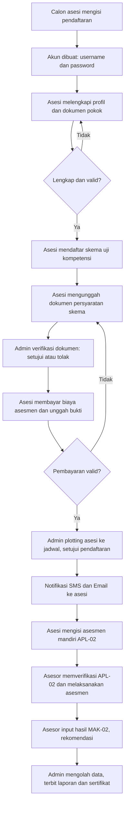
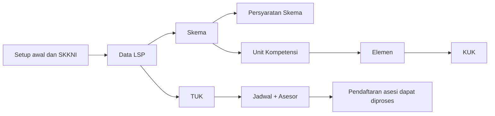

# Business Requirements Document (BRD)

## Aplikasi SiapKompeten— Sistem Informasi Lembaga Sertifikasi Profesi

| Atribut            | Isi                                                                                                      |
| ------------------ | -------------------------------------------------------------------------------------------------------- |
| Nama Aplikasi      | **SiapKompeten**                                                                                   |
| Dokumen            | Business Requirements Document (BRD)                                                                     |
| Versi              | 1.1 (Draft)                                                                                              |
| Tanggal            | 30 Oktober 2026                                                                                          |
| Author             | **Muhamad Arya Kurniawan**                                                                         |
| Referensi Utama    | Buku Panduan SILSP untuk Asesor dan Buku Panduan SILSP untuk Administrator (Dhega Febiharsa, 2018–2019) |
| Dokumen Pendamping | `System_Design_Aplikasi_LSPKU.md`                                                                      |
| Stack              | Laravel, MySQL, UUID (primary key), Tabler UI                                                            |

### Riwayat Revisi

| Versi | Tanggal     | Perubahan                                               | Author                 |
| ----- | ----------- | ------------------------------------------------------- | ---------------------- |
| 0.1   | 30 Okt 2026 | Draft awal dari analisis panduan SILSP                  | Muhamad Arya Kurniawan |
| 1.0   | 30 Okt 2026 | Penyusunan lengkap: kebutuhan, aturan bisnis, RBAC, NFR | Muhamad Arya Kurniawan |
| 1.1   | 30 Okt 2026 | Kesiapan multitenancy (multi-LSP): BR-15, NFR-17, cakupan & asumsi diperbarui | Muhamad Arya Kurniawan |

---

## 1. Pendahuluan

### 1.1 Latar Belakang

Lembaga Sertifikasi Profesi (LSP) mengelola siklus sertifikasi yang melibatkan banyak pihak: calon asesi, asesor, administrator LSP, dan publik. Proses manual (berkas fisik, rekap Excel, pesan WhatsApp/SMS terpisah) rawan duplikasi data, lambat, dan sulit diaudit. SILSP (Dhega Febiharsa) membuktikan bahwa proses ini dapat didigitalkan. **LSPKU** adalah aplikasi baru yang mengadopsi seluruh fungsi inti SILSP, dibangun ulang di atas Laravel, MySQL, UUID, dan Tabler UI, dengan penguatan pada keamanan, audit, dan kemudahan pengelolaan.

### 1.2 Tujuan Bisnis

| ID    | Tujuan                                                                  | Indikator Keberhasilan                                        |
| ----- | ----------------------------------------------------------------------- | ------------------------------------------------------------- |
| BO-01 | Mendigitalkan proses pendaftaran sampai penerbitan hasil uji kompetensi | ≥ 95% pendaftaran diproses tanpa berkas kertas               |
| BO-02 | Mempercepat verifikasi dokumen dan penjadwalan                          | Waktu verifikasi dokumen turun ≥ 50% dibanding proses manual |
| BO-03 | Menyeragamkan formulir asesmen (APL-01, APL-02, MAK-01, MAK-02, MAK-03) | 100% formulir dihasilkan sistem dengan data terisi otomatis   |
| BO-04 | Menyediakan data terpusat dan dapat diaudit                             | Seluruh perubahan data kritis tercatat (siapa, kapan, apa)    |
| BO-05 | Menyediakan informasi publik dan citra LSP (website frontpage)          | Konten website dapat dikelola admin tanpa developer           |
| BO-06 | Memberi komunikasi otomatis ke asesor dan asesi                         | Notifikasi terkirim otomatis pada setiap kejadian kunci       |

### 1.3 Ruang Lingkup

**Dalam lingkup (In Scope)**

| No | Modul                                                                                                           |
| -- | --------------------------------------------------------------------------------------------------------------- |
| 1  | Autentikasi, profil, ubah sandi, blokir akun                                                                    |
| 2  | Pengaturan awal (setup) dan data LSP                                                                            |
| 3  | Master standar: SKKNI, Skema, Persyaratan Skema, Unit Kompetensi, Elemen Kompetensi, Kriteria Unjuk Kerja (KUK) |
| 4  | Master TUK, Event Uji Kompetensi, Jadwal Uji Kompetensi                                                         |
| 5  | Manajemen Asesi (CRUD, impor Excel, blokir), verifikasi dokumen, persetujuan pendaftaran                        |
| 6  | Manajemen Asesor dan portal asesor                                                                              |
| 7  | Biaya skema, rekening bank, pembayaran dan validasinya                                                          |
| 8  | Asesmen mandiri (APL-02), verifikasi asesor, hasil asesmen (MAK-02)                                             |
| 9  | Pembuatan formulir PDF: APL-01, APL-02, MAK-01, MAK-02, MAK-03, daftar hadir                                    |
| 10 | Notifikasi SMS dan Email (outbox, inbox SMS, kirim ulang)                                                       |
| 11 | CMS website frontpage                                                                                           |
| 12 | Dashboard, laporan, dan sertifikat kompetensi                                                                   |

**Di luar lingkup (Out of Scope) fase 1**

| No | Item                                               | Catatan                                    |
| -- | -------------------------------------------------- | ------------------------------------------ |
| 1  | Integrasi langsung ke sistem BNSP (SIKI/SISKOMNAS) | Dipertimbangkan fase lanjut                |
| 2  | Payment gateway otomatis                           | Fase 1: transfer manual dan validasi admin |
| 3  | Aplikasi mobile native                             | Fase 1: web responsif                      |
| 4  | Ujian tertulis berbasis komputer (CBT)             | Hasil tes tertulis diinput asesor          |
| 5  | Multi-LSP **aktif** (banyak LSP beroperasi penuh)  | MVP fokus 1 LSP; skema, keamanan, dan routing siap multi-LSP sejak awal (partisi `institution_id`) |

### 1.4 Glosarium

| Istilah             | Arti                                                                                           |
| ------------------- | ---------------------------------------------------------------------------------------------- |
| LSP                 | Lembaga Sertifikasi Profesi                                                                    |
| Asesi               | Peserta uji kompetensi (calon asesi = pendaftar yang belum terverifikasi)                      |
| Asesor              | Penguji kompetensi yang ditugaskan pada jadwal                                                 |
| SKKNI               | Standar Kompetensi Kerja Nasional Indonesia (termasuk Standar Khusus/Internasional untuk unit) |
| Skema               | Paket sertifikasi yang dipilih asesi; terdiri atas satu atau lebih unit kompetensi             |
| Unit Kompetensi     | Bagian dari skema                                                                              |
| Elemen Kompetensi   | Bagian dari unit; menaungi KUK                                                                 |
| KUK                 | Kriteria Unjuk Kerja, tingkat paling rinci yang dinilai                                        |
| TUK                 | Tempat Uji Kompetensi                                                                          |
| Event               | Kegiatan penyelenggaraan uji kompetensi (payung dari satu atau beberapa jadwal)                |
| Jadwal / Jadwal TUK | Satu kelas/gelombang uji dengan satu skema, TUK, tanggal, dan asesor                           |
| APL-01              | Formulir Permohonan Sertifikasi Kompetensi                                                     |
| APL-02              | Formulir Asesmen Mandiri                                                                       |
| MAK-01              | Formulir Persetujuan Asesmen dan Kerahasiaan                                                   |
| MAK-02              | Formulir Hasil/Laporan Penilaian Asesmen                                                       |
| MAK-03              | Formulir pra-asesmen yang tersedia di portal asesor (sesuai panduan SILSP)                     |
| BK / K / PL         | Belum Kompeten / Kompeten / Asesmen Lanjut                                                     |
| Tenant              | Satu LSP yang datanya dipartisi dalam instalasi bersama melalui kolom `institution_id` (MVP: 1 tenant) |

---

## 2. Pemangku Kepentingan dan Aktor

| Aktor                           | Peran                                   | Kepentingan Utama                                                |
| ------------------------------- | --------------------------------------- | ---------------------------------------------------------------- |
| Super Admin                     | Pengelola platform / LSP                | Platform: CRUD LSP, aktivasi, audit lintas tenant; LSP: setup awal, pengguna admin, konfigurasi |
| Admin LSP                       | Operasional LSP ("ujung tombak" sistem) | Master data, verifikasi, penjadwalan, pembayaran, konten         |
| Asesor                          | Penguji                                 | Melihat jadwal, verifikasi APL-02, input hasil MAK-02            |
| Asesi / Calon Asesi             | Peserta                                 | Mendaftar, unggah dokumen, bayar, asesmen mandiri, melihat hasil |
| Pimpinan LSP (Direktur/Manajer) | Pengambil keputusan                     | Dashboard dan laporan (read-only)                                |
| Publik                          | Pengunjung website                      | Informasi LSP, skema, berita, verifikasi sertifikat              |
| Penyedia SMS/Email              | Sistem eksternal                        | Pengiriman notifikasi                                            |

> **Catatan sumber:** panduan yang tersedia hanya untuk Asesor dan Administrator. Portal Asesi disimpulkan dari diagram alur pendaftaran dan keterangan di panduan Administrator, sehingga detail layar asesi perlu divalidasi (lihat bagian 11).

---

## 3. Proses Bisnis

### 3.1 Alur Pendaftaran sampai Hasil Asesmen (To-Be LSPKU)

> Pada panduan, alur "pembayaran tidak valid" kembali ke tahap data dan dokumen persyaratan. LSPKU mempertahankan perilaku ini, ditambah status dan catatan penolakan agar asesi tahu apa yang harus diperbaiki.

### 3.2 Urutan Setup Administrator (Tahap Awal)

Urutan ini menjadi **ketergantungan data** (lihat BR-02 s.d. BR-06).

---

## 4. Kebutuhan Bisnis (Business Requirements)

| ID    | Kebutuhan Bisnis                                                                                                        | Tujuan       | Prioritas |
| ----- | ----------------------------------------------------------------------------------------------------------------------- | ------------ | --------- |
| BR-01 | Sistem harus menyediakan portal terpisah untuk Admin, Asesor, dan Asesi                                                 | BO-01        | Must      |
| BR-02 | Sistem harus mengelola struktur standar kompetensi berjenjang (SKKNI → Skema → Unit → Elemen → KUK)                 | BO-03        | Must      |
| BR-03 | Sistem harus mengelola persyaratan per skema (usia, pengalaman, administratif) dan menerima unggahan dokumen dari asesi | BO-02        | Must      |
| BR-04 | Sistem harus mengelola jadwal uji (event, TUK, asesor, kuota) dan memplot asesi                                         | BO-02        | Must      |
| BR-05 | Sistem harus mengelola biaya per skema, rekening bank penerima, dan validasi pembayaran                                 | BO-01        | Must      |
| BR-06 | Sistem harus mendukung asesmen mandiri (APL-02), verifikasi asesor, dan input hasil (MAK-02) secara daring              | BO-01, BO-03 | Must      |
| BR-07 | Sistem harus menghasilkan formulir PDF terisi otomatis                                                                  | BO-03        | Must      |
| BR-08 | Sistem harus mengirim notifikasi SMS dan Email pada kejadian kunci dan menyimpan arsipnya                               | BO-06        | Must      |
| BR-09 | Sistem harus menyediakan impor asesi massal dari Excel dengan pratinjau                                                 | BO-02        | Must      |
| BR-10 | Sistem harus menyediakan CMS website frontpage LSP                                                                      | BO-05        | Should    |
| BR-11 | Sistem harus menyediakan dashboard statistik dan laporan                                                                | BO-04        | Should    |
| BR-12 | Sistem harus mencatat jejak audit perubahan data kritis                                                                 | BO-04        | Should    |
| BR-13 | Sistem harus menerbitkan sertifikat/laporan kompetensi dengan verifikasi keaslian                                       | BO-01        | Should    |
| BR-14 | Sistem harus aman: HTTPS, RBAC, perlindungan data pribadi (NIK, dokumen)                                                | BO-04        | Must      |
| BR-15 | Sistem harus menjaga isolasi data antar LSP (tenant) dan siap melayani lebih dari satu LSP tanpa perubahan skema | BO-04        | Must      |

---

## 5. Kebutuhan Fungsional

**Legenda prioritas (MoSCoW):** M = Must, S = Should, C = Could.
**Sumber:** `AS-x` = Panduan Asesor bagian x; `AD-x` = Panduan Administrator bagian x; `Baru` = penambahan LSPKU.

### 5.1 Autentikasi, Akun, dan Profil (AUTH)

| ID         | Kebutuhan                                                                                                                   | Prio | Sumber         |
| ---------- | --------------------------------------------------------------------------------------------------------------------------- | ---- | -------------- |
| FR-AUTH-01 | Login per portal: Admin memakai username; Asesor memakai No. KTP/NIK; Asesi memakai NIK/email. Terdapat opsi "Ingat Saya"   | M    | AS-3.1, AD-4   |
| FR-AUTH-02 | Bila kata sandi salah atau sesi idle, tampil **lock screen** (hanya input password, atau login sebagai pengguna lain) | M    | AS-3.1         |
| FR-AUTH-03 | Ubah sandi: password lama, password baru, konfirmasi; minimal 8 karakter; tombol Proses/Batal                               | M    | AS-9, AD-17    |
| FR-AUTH-04 | Lupa sandi melalui tautan email                                                                                             | S    | Baru           |
| FR-AUTH-05 | Pembatasan percobaan login (rate limit) dan log login                                                                       | S    | Baru           |
| FR-AUTH-06 | Profil: tampilan detail dan form Ubah Profil; foto maks. 2 MB                                                               | M    | AS-3.2, AD-3.2 |
| FR-AUTH-07 | Admin dapat memblokir dan membuka blokir akun asesi; akun terblokir tidak dapat login                                       | M    | AD-7.1         |
| FR-AUTH-08 | Pengelolaan akun admin dan hak akses (peran) oleh Super Admin                                                               | M    | Baru           |

### 5.2 Pengaturan Awal dan Data LSP (SET, LSP)

| ID        | Kebutuhan                                                                                                                                                                                                            | Prio | Sumber           |
| --------- | -------------------------------------------------------------------------------------------------------------------------------------------------------------------------------------------------------------------- | ---- | ---------------- |
| FR-SET-01 | Wizard **Pengaturan Awal** sekali pakai: Nama LSP, Meta Title, Meta Keywords, URL Domain (tanpa `http://`), Standar KKNI, Legalitas SKKNI (Keputusan Menteri/payung hukum). Menu hilang setelah SKKNI terisi | M    | AD-2             |
| FR-SET-02 | Identitas setup dirujuk oleh template email, SMS, dan homepage                                                                                                                                                       | M    | AD-2             |
| FR-LSP-01 | CRUD data LSP: kode, nama, direktur, nomor lisensi dan masa berlaku, alamat, kontak, kode embed Google Maps                                                                                                          | M    | AD-5, 16.8–16.9 |
| FR-LSP-02 | Perubahan data LSP langsung berdampak pada seluruh portal dan dokumen (single source of truth)                                                                                                                       | M    | AD-5.2           |
| FR-LSP-03 | Pengingat masa berlaku lisensi LSP dan TUK (mis. H-90, H-30)                                                                                                                                                         | C    | Baru             |
| FR-LSP-04 | Kode Google Maps hanya menerima iframe `google.com/maps` (sanitasi)                                                                                                                                                | S    | Baru             |

### 5.3 Master Standar Kompetensi (STD)

| ID        | Kebutuhan                                                                                                                                            | Prio | Sumber      |
| --------- | ---------------------------------------------------------------------------------------------------------------------------------------------------- | ---- | ----------- |
| FR-STD-01 | CRUD **SKKNI** (kode, nama, legalitas)                                                                                                         | M    | AD-2, 9.1   |
| FR-STD-02 | CRUD **Skema**: kode, nama, SKKNI, keterangan bukti yang diperoleh; Aktifkan/Nonaktifkan                                                       | M    | AD-9.1–9.2 |
| FR-STD-03 | Skema nonaktif tidak dapat dipilih asesi baru tetapi tetap dirujuk data lama                                                                         | M    | AD-9.2      |
| FR-STD-04 | CRUD **Persyaratan Skema** (usia, pengalaman belajar/kerja, administratif lain); tampil jumlah persyaratan; tombol Input atau Ubah Persyaratan | M    | AD-9.3–9.4 |
| FR-STD-05 | CRUD **Unit Kompetensi**: kode, nama, jenis standar (SKKNI / Standar Khusus / Standar Internasional-ISO); Unit berdiri mandiri di bawah standar agar dapat digunakan lintas skema tanpa duplikasi | M    | AD-11       |
| FR-STD-05b| **Pemetaan Unit ke Skema (Many-to-Many)**: Menghubungkan unit kompetensi ke skema via tabel junction (`skema_units`) dengan pengaturan jenis unit (inti/pilihan/fungsional) dan urutan; memungkinkan fleksibilitas materi uji (FR.IA) per skema | M | Keputusan Desain |
| FR-STD-06 | CRUD **Elemen Kompetensi** per unit; tampil jumlah elemen (N)                                                                                  | M    | AD-12       |
| FR-STD-07 | CRUD **KUK** per elemen; elemen harus ada sebelum KUK                                                                                          | M    | AD-12       |
| FR-STD-08 | Impor skema/unit/elemen/KUK dari Excel                                                                                                               | S    | Baru        |
| FR-STD-09 | Duplikasi skema (salin struktur unit-elemen-KUK) untuk revisi standar                                                                                | C    | Baru        |

### 5.4 TUK, Event, dan Jadwal (SCH)

| ID        | Kebutuhan                                                                                                                                                                                                               | Prio | Sumber       |
| --------- | ----------------------------------------------------------------------------------------------------------------------------------------------------------------------------------------------------------------------- | ---- | ------------ |
| FR-SCH-01 | CRUD **TUK**: kode, LSP induk, nama, jenis TUK, nomor lisensi, masa berlaku, alamat/wilayah; tampil jumlah jadwal yang terselenggara                                                                              | M    | AD-7         |
| FR-SCH-02 | TUK wajib ada sebelum jadwal dibuat                                                                                                                                                                                     | M    | AD-7         |
| FR-SCH-03 | **Event Uji Kompetensi**: nama kegiatan, tempat, tanggal/waktu, jumlah peserta; ringkasan dari jadwal                                                                                                             | M    | AD-6         |
| FR-SCH-04 | CRUD **Jadwal**: Nama/Judul Kegiatan, Tahun, Periode (bulan), Gelombang/Grup, Tanggal, Jam, Kuota Peserta, SKKNI, Skema, TUK, Lingkup Asesor (Wilayah/Nonwilayah), Penugasan Multi-Asesor (Utama, Pendamping, Observer untuk pengujian paralel), Nomor Surat Tugas | M    | AD-8.2, Kebutuhan Operasional |
| FR-SCH-05 | Lingkup Asesor "Wilayah" merekomendasikan asesor yang provinsinya sama dengan TUK                                                                                                                                       | M    | AD-8.2       |
| FR-SCH-06 | Jadwal dapat dihapus **hanya jika belum ada peserta**                                                                                                                                                             | M    | AD-8.3       |
| FR-SCH-07 | Daftar jadwal menampilkan skema, jumlah peserta, asesor, TUK + alamat; tombol Peserta dan Presensi; bila kosong tombol "Belum Ada Peserta"                                                                              | M    | AD-8.1, AS-4 |
| FR-SCH-08 | **Presensi** (daftar hadir PDF) ter-update otomatis seketika asesi ditambahkan ke jadwal                                                                                                                          | M    | AD-8.1       |
| FR-SCH-09 | Saat asesor diplot ke jadwal, kirim SMS dan Email ke asesor                                                                                                                                                             | M    | AS-4, AS-8   |
| FR-SCH-10 | Validasi bentrok jadwal asesor (tanggal/jam sama)                                                                                                                                                                       | S    | Baru         |
| FR-SCH-11 | Kalender jadwal (tampilan bulanan)                                                                                                                                                                                      | C    | Baru         |

### 5.5 Manajemen Asesi (ASI)

| ID        | Kebutuhan                                                                                                                                                                                | Prio | Sumber           |
| --------- | ---------------------------------------------------------------------------------------------------------------------------------------------------------------------------------------- | ---- | ---------------- |
| FR-ASI-01 | **Registrasi mandiri** calon asesi di portal publik; sistem membuat akun                                                                                                           | M    | Alur (AS-2/AD-3) |
| FR-ASI-02 | Asesi melengkapi profil dan dokumen pokok; validasi digit NIK persis 16 angka numerik; batas ukuran dan tipe berkas diverifikasi ketat                                                    | M    | Alur             |
| FR-ASI-03 | Daftar asesi dengan pencarian, filter **Provinsi** dan **Kota/Kabupaten** (dengan jumlah asesi per wilayah)                                                                  | M    | AD-7.1           |
| FR-ASI-04 | Tab status: Kompeten, Belum Kompeten, Belum Terverifikasi, Terverifikasi, Diblokir                                                                                                       | M    | AD-7.1           |
| FR-ASI-05 | Detail asesi: nama, foto, nomor pendaftaran, pendidikan terakhir, skema diikuti, kelengkapan dokumen                                                                                     | M    | AD-7.1           |
| FR-ASI-06 | Blokir dari tab Kompeten/Belum Kompeten/Belum Terverifikasi/Terverifikasi; Buka Blokir dari tab Diblokir                                                                                 | M    | AD-7.1           |
| FR-ASI-07 | Hapus asesi hanya dari tab Belum Terverifikasi                                                                                                                                           | M    | AD-7.1           |
| FR-ASI-08 | **Impor Excel**: unduh template (.xlsx), unggah, **Preview** (kolom kosong ditandai merah), tombol Import; hasil masuk tab Belum Terverifikasi dan daftar Calon Asesi (Baru) | M    | AD-7.2           |
| FR-ASI-09 | Kolom Kecamatan, Kota, Provinsi pada impor memakai kode 6 digit (sheet Kode Wilayah) dan boleh kosong; dapat dilengkapi lewat Update Data Asesi                                          | M    | AD-7.2           |
| FR-ASI-10 | Laporan hasil impor (baris sukses/gagal dan alasannya) dan deteksi duplikat NIK                                                                                                          | S    | Baru             |
| FR-ASI-11 | **Widget Panduan Sistem**: Download dokumen & modul interaktif di dashboard asesi memuat panduan penggunaan sistem dan alur sertifikasi                                                    | M    | Kebutuhan Asesi  |
| FR-ASI-12 | **Strict Phase Gating (Anti-Lompat Tahapan)**: Portal asesi mengunci tahapan berikutnya (contoh: isi APL-02) sebelum tahapan dasar (dokumen APL-01) disetujui valid oleh admin/sistem     | M    | Kebutuhan Sistem |

### 5.6 Verifikasi Dokumen dan Persetujuan Pendaftaran (REG)

| ID        | Kebutuhan                                                                                                                                   | Prio | Sumber |
| --------- | ------------------------------------------------------------------------------------------------------------------------------------------- | ---- | ------ |
| FR-REG-01 | Asesi memilih skema dan mengunggah dokumen sesuai persyaratan skema                                                                         | M    | AD-7.3 |
| FR-REG-02 | Admin melihat dokumen (pop-up pratinjau) dan **Setujui** atau **Tolak** per dokumen; tombol keputusan hilang setelah diputuskan | M    | AD-7.3 |
| FR-REG-03 | Tombol Verifikasi hanya muncul bagi asesi yang sudah mendaftar pada suatu skema                                                             | M    | AD-7.3 |
| FR-REG-04 | Notifikasi email ke asesi saat dokumen disetujui/ditolak (disertai catatan alasan)                                                          | M    | AD-7.4 |
| FR-REG-05 | Admin **Setujui Pendaftaran** dengan memilih jadwal (jadwal dan asesor harus sudah ada) atau **Tolak Pendaftaran**              | M    | AD-7.4 |
| FR-REG-06 | Notifikasi SMS dan Email ke asesi saat pendaftaran disetujui/ditolak                                                                        | M    | AD-7.4 |
| FR-REG-07 | Kuota jadwal divalidasi saat plotting; jadwal penuh tidak dapat dipilih                                                                     | M    | AD-8.2 |
| FR-REG-08 | Pemindahan asesi antar jadwal (sebelum hari asesmen) dengan jejak audit                                                                     | S    | Baru   |

### 5.7 Biaya dan Pembayaran (PAY)

| ID        | Kebutuhan                                                                                                                         | Prio | Sumber |
| --------- | --------------------------------------------------------------------------------------------------------------------------------- | ---- | ------ |
| FR-PAY-01 | CRUD **Rekening Bank** penerima per LSP: bank, nomor rekening, nama pemilik                                                 | M    | AD-13  |
| FR-PAY-02 | CRUD **Biaya** per LSP, SKKNI, Skema, **Jenis Biaya** (tetap/variabel), **Nominal** (angka bulat tanpa pemisah) | M    | AD-13  |
| FR-PAY-03 | Biaya dapat ditanggung peserta atau fasilitator/sponsor (nominal peserta bisa nol)                                                | M    | AD-13  |
| FR-PAY-04 | Asesi melihat tagihan dan rekening, mengunggah bukti bayar                                                                        | M    | Alur   |
| FR-PAY-05 | Admin **validasi pembayaran** (valid/tidak valid + catatan). Tidak valid mengembalikan asesi ke tahap perbaikan             | M    | Alur   |
| FR-PAY-06 | Input nominal diformat otomatis di UI, disimpan sebagai angka murni                                                               | S    | AD-13  |

### 5.7a Portal Asesor (ASR)

| ID        | Kebutuhan                                                                                                                                                                                                                                                                                                                                   | Prio | Sumber                    |
| --------- | ------------------------------------------------------------------------------------------------------------------------------------------------------------------------------------------------------------------------------------------------------------------------------------------------------------------------------------------- | ---- | ------------------------- |
| FR-ASR-01 | Admin mendaftarkan asesor; asesor melengkapi profil                                                                                                                                                                                                                                                                                         | M    | AS-3.2                    |
| FR-ASR-02 | Data asesor: nomor induk/register, nomor lisensi, masa berlaku lisensi, KTP, nama + gelar depan/belakang, tempat/tanggal lahir, alamat lengkap (RT, RW, kelurahan, kecamatan, kota, provinsi, kode pos), HP, email, pendidikan terakhir + tahun lulus, bidang keahlian, kebangsaan, institusi asal (alamat, telp, fax, email), status aktif | M    | AS-3.2                    |
| FR-ASR-03 | Nomor register dan lisensi asesor hanya dapat diubah admin (read-only di profil asesor)                                                                                                                                                                                                                                                     | M    | AS-3.2 (tampilan abu-abu) |
| FR-ASR-04 | **Dashboard asesor**: kartu Jadwal Asesmen Anda, Skema Asesmen Anda, Portofolio Asesmen Anda, Asesi yang Anda Asesori; grafik pendaftar/kandidat per tahun, kelompok usia, jenis kelamin, kemajuan proses administratif                                                                                                               | M    | AS-1                      |
| FR-ASR-05 | Menu: Home, Jadwal Uji Kompetensi, SMS Notifikasi, Ubah Sandi; tombol toggle menu dan breadcrumb                                                                                                                                                                                                                                            | M    | AS-1                      |
| FR-ASR-06 | Halaman jadwal asesor: kegiatan, tanggal, jam, TUK, skema, kapasitas, peserta terjadwal; tombol Peserta dan Presensi                                                                                                                                                                                                                        | M    | AS-4                      |
| FR-ASR-07 | Daftar peserta per jadwal dengan aksi: Unduh APL-01, Penilaian Pra-Asesmen (APL-02), Unduh APL-02, Unduh MAK-03, Input Hasil Asesmen (MAK-02)                                                                                                                                                                                               | M    | AS-5                      |
| FR-ASR-08 | Masa berlaku lisensi asesor kedaluwarsa memblokir penugasan baru                                                                                                                                                                                                                                                                            | S    | Baru                      |

### 5.8 Asesmen Mandiri dan Hasil Asesmen (ASM)

| ID        | Kebutuhan                                                                                                                                                                                                       | Prio | Sumber         |
| --------- | --------------------------------------------------------------------------------------------------------------------------------------------------------------------------------------------------------------- | ---- | -------------- |
| FR-ASM-01 | **APL-02 oleh asesi**: per KUK, asesi menjawab Ya/Tidak dan mengisi bukti pendukung, **sebelum** waktu uji                                                                                          | M    | AS-5 (catatan) |
| FR-ASM-02 | **Verifikasi APL-02 oleh asesor**: centang *Valid, Autentik, Terkini, Memadai* per KUK; isi Bukti-Bukti Kompetensi; Simpan Jawaban; Unduh Form Jawaban; Kembali                                         | M    | AS-5           |
| FR-ASM-03 | Verifikasi asesor dapat dilakukan pada hari pelaksanaan; unduh dan cetak APL-02 dilakukan sebelum uji                                                                                                           | M    | AS-5 (catatan) |
| FR-ASM-04 | Notifikasi sukses simpan ("Penilaian Asesor berhasil disimpan")                                                                                                                                                 | M    | AS-5           |
| FR-ASM-05 | **MAK-02 per KUK**: pilihan Pencapaian Ya/Tidak (hijau jika tercapai, merah jika tidak), bukti ke-n, centang Valid/Autentik/Terkini/Memadai                                                               | M    | AS-7           |
| FR-ASM-06 | **MAK-02 per unit** dan per metode (Observasi, Tes Lisan, Tes Tertulis): centang bukti Langsung / Tidak Langsung / Tambahan, Pencapaian, Keputusan (**Kompeten / Belum Kompeten / Asesmen Lanjut**) | M    | AS-7           |
| FR-ASM-07 | **Rekomendasi** akhir: Direkomendasikan / Tidak Direkomendasikan; sistem menampilkan persentase "Asesi dinyatakan X% KOMPETEN" setelah simpan                                                             | M    | AS-7           |
| FR-ASM-08 | Checkbox Valid/Autentik/Terkini/Memadai dan bukti di MAK-02 terisi otomatis dari verifikasi APL-02; asesor dapat melengkapi bila kosong                                                                         | M    | AS-7           |
| FR-ASM-09 | Asesor wajib memberi umpan balik; asesi dapat mengisi kuesioner proses asesmen                                                                                                                                  | S    | AS-7           |
| FR-ASM-10 | Hasil dapat disimpan sebagai draf sebelum final; setelah final terkunci (perubahan hanya via admin dengan alasan)                                                                                               | S    | Baru           |
| FR-ASM-11 | Tanda tangan asesor dan asesi (unggah/ TTD digital) pada formulir                                                                                                                                               | C    | AS-7 (butir 5) |
| FR-ASM-12 | Status asesi otomatis menjadi Kompeten/Belum Kompeten berdasarkan keputusan unit dan rekomendasi                                                                                                                | M    | AD-7.1         |

### 5.9 Formulir PDF (FRM)

| ID        | Kebutuhan                                                                                                                                                                    | Prio | Sumber        |
| --------- | ---------------------------------------------------------------------------------------------------------------------------------------------------------------------------- | ---- | ------------- |
| FR-FRM-01 | Generate PDF **APL-01** (permohonan sertifikasi), **APL-02**, **MAK-01**, **MAK-02**, **MAK-03** dengan kop LSP dan data asesi terisi otomatis | M    | AS-6, AD-14   |
| FR-FRM-02 | Admin dapat mengunduh formulir dari dashboard dan dari daftar peserta jadwal                                                                                                 | M    | AD-14         |
| FR-FRM-03 | Pratinjau PDF di browser dan tombol cetak                                                                                                                                    | M    | AS-6          |
| FR-FRM-04 | Nama berkas baku: `FORM-APL-01-<SKEMA>-<NAMA ASESI>.pdf`                                                                                                                   | S    | AS-6 (contoh) |
| FR-FRM-05 | Daftar hadir (presensi) PDF per jadwal                                                                                                                                       | M    | AD-8.1        |

### 5.10 Notifikasi (NTF)

| ID        | Kebutuhan                                                                                                                               | Prio | Sumber     |
| --------- | --------------------------------------------------------------------------------------------------------------------------------------- | ---- | ---------- |
| FR-NTF-01 | Notifikasi SMS dan Email untuk: plotting asesor, dokumen disetujui/ditolak, pendaftaran disetujui/ditolak, hasil asesmen                | M    | AS-8, AD-7 |
| FR-NTF-02 | **SMS Keluar**: arsip + status *Menunggu / Terkirim / Gagal Terkirim*, pencarian, tombol **Kirim Ulang** untuk yang gagal | M    | AD-15      |
| FR-NTF-03 | **SMS Masuk**: pesan yang diterima gateway                                                                                        | S    | AD-15      |
| FR-NTF-04 | Asesor melihat arsip SMS miliknya; Email dilihat dari kotak masuk masing-masing                                                         | M    | AS-8       |
| FR-NTF-05 | Template pesan dapat diatur admin (variabel: nama, tanggal, tempat, tautan)                                                             | S    | Baru       |
| FR-NTF-06 | Kanal tambahan WhatsApp melalui adapter (opsional)                                                                                      | C    | Baru       |
| FR-NTF-07 | Lonceng notifikasi di aplikasi (in-app)                                                                                                 | C    | Baru       |

### 5.11 CMS Website Frontpage (CMS)

| ID        | Kebutuhan                                                                                                                                      | Prio | Sumber         |
| --------- | ---------------------------------------------------------------------------------------------------------------------------------------------- | ---- | -------------- |
| FR-CMS-01 | CRUD konten: Judul, Sub Judul, Tanggal Terbit, Jam Terbit, Kategori/Grup, isi (editor kaya dengan gambar)                                      | M    | AD-16.1        |
| FR-CMS-02 | Kategori sesuai bagian template: Slide Banner, Welcome, Layanan, Asesor, Portfolio, Berita, Hubungi Kami, Google Maps, Form Login, Footer Menu | M    | AD-16.2–16.10 |
| FR-CMS-03 | Alamat, kontak, dan peta diambil dari data LSP                                                                                                 | M    | AD-16.8–16.9  |
| FR-CMS-04 | Halaman publik: daftar skema aktif, daftar asesor, berita, kontak, tombol Daftar dan Masuk                                                     | M    | AD-16          |
| FR-CMS-05 | Meta title/keywords dari setup awal dipakai untuk SEO                                                                                          | S    | AD-2           |
| FR-CMS-06 | Verifikasi keaslian sertifikat via nomor/QR                                                                                                    | S    | Baru           |

### 5.12 Dashboard, Laporan, dan Sertifikat (RPT)

| ID        | Kebutuhan                                                                                                                                                                                | Prio | Sumber      |
| --------- | ---------------------------------------------------------------------------------------------------------------------------------------------------------------------------------------- | ---- | ----------- |
| FR-RPT-01 | Dashboard admin: kartu ringkas (skema, asesor, asesi/calon asesi, uji kompetensi, jadwal asesmen) dan grafik data per tahun, kelompok usia, jenis kelamin, kemajuan proses administratif | M    | Sampul/AS-1 |
| FR-RPT-02 | "Kemajuan Proses Administratif": persentase proses asesmen dan hasil (kompeten/belum kompeten)                                                                                           | M    | Sampul/AS-1 |
| FR-RPT-03 | Laporan rekap: asesi per skema/periode/wilayah, hasil asesmen, pembayaran; ekspor Excel dan PDF                                                                                          | S    | Alur        |
| FR-RPT-04 | **Sertifikat Kompetensi BNSP**: Sistem e-LSP bertindak sebagai trigger cetak dan data otentikasi setelah FR.AK.05 disetujui (blangko fisik eksklusif dari BNSP Pusat). Mengelola dua kolom unik terpisah: `no_seri_blangko` (kertas hologram fisik) dan `no_registrasi` (register lisensi nasional); validasi format regex standar BNSP `^[A-Z0-9\-\.]+\.[A-Z0-9\-\.]+\.\d{5,}\.\d{4}$` | M | Keputusan BNSP |
| FR-RPT-05 | Dashboard pimpinan (read-only)                                                                                                                                                           | C    | Baru        |

---

## 6. Aturan Bisnis (Business Rules)

| ID         | Aturan                                                                                                                                       | Sumber      |
| ---------- | -------------------------------------------------------------------------------------------------------------------------------------------- | ----------- |
| BR-RULE-01 | Setup Awal hanya dapat dilakukan sekali; setelah SKKNI terisi menu setup disembunyikan                                                       | AD-2        |
| BR-RULE-02 | Elemen harus ada sebelum KUK dapat diinput                                                                                                   | AD-12       |
| BR-RULE-03 | SKKNI harus ada sebelum Skema dibuat                                                                                                         | AD-9.1      |
| BR-RULE-04 | TUK harus ada sebelum Jadwal dibuat                                                                                                          | AD-7        |
| BR-RULE-05 | Jadwal beserta asesornya harus ada sebelum pendaftaran asesi disetujui                                                                       | AD-7.4      |
| BR-RULE-06 | Jadwal hanya dapat dihapus bila belum ada peserta                                                                                            | AD-8.3      |
| BR-RULE-07 | Skema hanya dapat dihapus bila tidak punya persyaratan (dan tidak dirujuk data lain); skema yang sudah dipakai cukup **dinonaktifkan** | AD-9.2, 9.5 |
| BR-RULE-08 | Asesi hanya dapat dihapus dari status Belum Terverifikasi                                                                                    | AD-7.1      |
| BR-RULE-09 | Dokumen yang sudah disetujui/ditolak tidak dapat diputuskan ulang oleh tombol biasa                                                          | AD-7.3      |
| BR-RULE-10 | Tombol Verifikasi hanya untuk asesi yang sudah mendaftar pada skema                                                                          | AD-7.3      |
| BR-RULE-11 | Satu jadwal = satu kelas = satu asesor utama; jumlah peserta ≤ kuota                                                                        | AD-8.2      |
| BR-RULE-12 | Biaya ditetapkan per skema; nominal disimpan angka murni                                                                                     | AD-13       |
| BR-RULE-13 | APL-02 diisi asesi sebelum hari uji; verifikasi asesor boleh pada hari pelaksanaan; unduh/cetak sebelum uji                                  | AS-5        |
| BR-RULE-14 | Pencapaian KUK "Tidak" ditandai merah, "Ya" hijau                                                                                            | AS-7        |
| BR-RULE-15 | Keputusan unit ∈ {Kompeten, Belum Kompeten, Asesmen Lanjut}; rekomendasi ∈ {Direkomendasikan, Tidak Direkomendasikan}                      | AS-7        |
| BR-RULE-16 | Asesi terblokir tidak dapat mengakses sistem                                                                                                 | AD-7.1      |
| BR-RULE-17 | SMS gagal dapat dikirim ulang; status ∈ {Menunggu, Terkirim, Gagal}                                                                         | AD-15       |
| BR-RULE-18 | Asesor hanya melihat jadwal, peserta, dan SMS miliknya sendiri                                                                               | AS-4, AS-8  |
| BR-RULE-19 | Perubahan data LSP bersifat global (dirujuk portal asesor, asesi, dan homepage)                                                              | AD-5.2      |
| BR-RULE-20 | Data referensi yang sudah dipakai transaksi tidak dihapus permanen (soft delete + nonaktif)                                                  | Baru        |
| BR-RULE-21 | Keputusan hasil asesmen final tidak dapat diubah asesor; koreksi hanya oleh admin dengan alasan dan tercatat di audit                        | Baru        |

---

## 7. Hak Akses (RBAC)

C = Create, R = Read, U = Update, D = Delete, A = Approve/aksi khusus, `-` = tidak ada akses, `own` = hanya data miliknya.

| Modul                                    | Super Admin | Admin LSP       | Asesor          | Asesi           | Pimpinan | Publik          |
| ---------------------------------------- | ----------- | --------------- | --------------- | --------------- | -------- | --------------- |
| Setup awal                               | CRU         | -               | -               | -               | -        | -               |
| Pengguna & peran                         | CRUD        | R               | -               | -               | -        | -               |
| Data LSP                                 | CRUD        | CRUD            | -               | -               | R        | R (profil)      |
| SKKNI/Skema/Unit/Elemen/KUK              | CRUD        | CRUD            | R               | R (skema aktif) | R        | R (skema aktif) |
| TUK, Event, Jadwal                       | CRUD        | CRUD            | R (own)         | R (own)         | R        | -               |
| Asesi                                    | CRUD        | CRUD + blokir   | R (peserta own) | RU (own)        | R        | -               |
| Impor asesi                              | CRU         | CRU             | -               | -               | -        | -               |
| Verifikasi dokumen / setujui pendaftaran | A           | A               | -               | -               | -        | -               |
| Biaya & rekening                         | CRUD        | CRUD            | -               | R               | R        | -               |
| Pembayaran                               | A           | A               | -               | CR (own)        | R        | -               |
| APL-02 (isi mandiri)                     | -           | R               | R (own)         | CRU (own)       | -        | -               |
| APL-02 (verifikasi)                      | -           | R               | CRU (own)       | R (own)         | -        | -               |
| MAK-02 (hasil)                           | -           | R + koreksi     | CRU (own)       | R (own)         | R        | -               |
| Formulir PDF                             | A           | A               | A (own)         | A (own)         | -        | -               |
| Notifikasi (outbox/inbox)                | R           | R + kirim ulang | R (own)         | R (own)         | -        | -               |
| CMS frontpage                            | CRUD        | CRUD            | -               | -               | -        | R               |
| Laporan & dashboard                      | R           | R               | R (own)         | -               | R        | -               |
| Sertifikat                               | A           | A               | -               | R (own)         | R        | verifikasi      |
| Audit log                                | R           | R               | -               | -               | R        | -               |

> **Multitenancy:** seluruh akses peran Admin LSP, Asesor, Asesi, dan Pimpinan dibatasi pada tenant (`institution_id`) aktif. Super Admin platform dapat mengakses lintas tenant hanya melalui area `/platform` dan setiap aksesnya diaudit. MVP hanya memiliki satu tenant.

---

## 8. Kebutuhan Non-Fungsional

| ID     | Kategori             | Kebutuhan                                                                                                            |
| ------ | -------------------- | -------------------------------------------------------------------------------------------------------------------- |
| NFR-01 | Platform             | Aplikasi web (Laravel + MySQL), diakses via browser modern (Chrome, Firefox, Edge, Safari)                           |
| NFR-02 | UI/UX                | Tabler UI; responsif desktop, tablet, smartphone; bahasa antarmuka Bahasa Indonesia                                  |
| NFR-03 | Identitas data       | Seluruh primary key menggunakan **UUID**; URL tidak memuat ID berurutan                                        |
| NFR-04 | Keamanan transport   | HTTPS wajib (panduan SILSP ditampilkan "Not secure"); HSTS                                                           |
| NFR-05 | Keamanan akun        | Hash password (bcrypt/argon2), min. 8 karakter, rate limiting, CSRF, proteksi XSS/SQLi                               |
| NFR-06 | Data pribadi         | NIK dan dokumen identitas dilindungi: akses berbasis peran, berkas pada penyimpanan privat, mengikuti prinsip UU PDP |
| NFR-07 | Unggah berkas        | Validasi tipe (PDF/JPG/PNG), ukuran (foto ≤ 2 MB; dokumen sesuai konfigurasi), pemindaian nama berkas aman          |
| NFR-08 | Kinerja              | Halaman daftar < 2 detik untuk 10.000 asesi (pagination, indeks); notifikasi diproses asinkron (queue)               |
| NFR-09 | Ketersediaan         | Target 99% jam kerja; backup harian terenkripsi, retensi min. 30 hari                                                |
| NFR-10 | Skalabilitas         | Mendukung ribuan asesi dan ratusan jadwal per tahun tanpa perubahan arsitektur                                       |
| NFR-11 | Audit                | Log aktivitas untuk create/update/delete data kritis, login, keputusan verifikasi, hasil asesmen                     |
| NFR-12 | Integritas           | Transaksi database untuk operasi multi-tabel (plotting, simpan hasil)                                                |
| NFR-13 | Keandalan notifikasi | Retry otomatis, status terlacak, kirim ulang manual                                                                  |
| NFR-14 | Pemeliharaan         | Kode terstruktur, test otomatis, migrasi dan seeder terversi                                                         |
| NFR-15 | Aksesibilitas        | Kontras warna memadai; status tidak hanya dibedakan warna (ikon/teks pendamping), mis. hijau/merah pada pencapaian   |
| NFR-16 | Kompatibilitas cetak | PDF formulir ukuran A4, mengikuti format baku BNSP/LSP                                                               |
| NFR-17 | Isolasi tenant       | Seluruh data operasional dipartisi per `institution_id`; akses lintas tenant ditolak; tidak ada kebocoran data antar LSP      |

---

## 9. Asumsi, Batasan, dan Ketergantungan

| Jenis          | Uraian                                                                                                  |
| -------------- | ------------------------------------------------------------------------------------------------------- |
| Asumsi         | MVP satu instalasi melayani satu LSP; arsitektur data dan keamanan sudah siap multi-LSP (partisi `institution_id`) |
| Asumsi         | Format formulir APL-01/02, MAK-01/02/03 mengikuti templat LSP dan perlu disediakan sebagai acuan layout |
| Asumsi         | Penyedia SMS gateway tersedia melalui API HTTP; Email melalui SMTP                                      |
| Asumsi         | Portal asesi tidak tercakup panduan; dirancang dari diagram alur                                        |
| Batasan        | Fase 1 tanpa payment gateway dan tanpa integrasi sistem BNSP                                            |
| Batasan        | Unit kompetensi diasumsikan milik satu skema (sesuai SILSP); lihat pertanyaan terbuka                   |
| Ketergantungan | Server dengan PHP, MySQL, queue worker, penyimpanan berkas privat, SMTP, SMS gateway                    |
| Ketergantungan | Data wilayah (provinsi, kota, kecamatan) kode 6 digit tersedia untuk impor                              |

---

## 10. Analisis Kesenjangan: SILSP → LSPKU

| Aspek               | SILSP (panduan)                             | LSPKU (usulan)                                                          |
| ------------------- | ------------------------------------------- | ----------------------------------------------------------------------- |
| Teknologi           | PHP (`media.php?module=...`), versi Alpha | Laravel, route bersih, arsitektur modular                               |
| ID data             | Nomor berurutan (mis. `idj=138`)          | UUID di seluruh tabel dan URL                                           |
| UI                  | Template admin generik                      | Tabler UI konsisten                                                     |
| Hak akses           | Tiga portal terpisah                        | RBAC berbasis peran dan kebijakan (policy)                              |
| Keamanan            | HTTP ("Not secure")                         | HTTPS, rate limit, audit log                                            |
| Notifikasi          | SMS dan Email sinkron                       | Queue, retry, template, adapter kanal                                   |
| Pembayaran          | Validasi manual                             | Validasi manual + status dan catatan terstruktur (siap payment gateway) |
| Hasil asesmen       | Input online                                | Draf/final, penguncian, sertifikat berQR                                |
| Impor               | Excel + preview                             | Excel + preview + laporan galat + deteksi duplikat                      |
| Pengelolaan dokumen | Verifikasi satu per satu                    | Verifikasi massal (opsional), versi dokumen                             |
| Pelaporan           | Dashboard dasar                             | Dashboard + ekspor laporan                                              |

---

## 11. Pertanyaan Terbuka

| No | Pertanyaan                                                                                                                      | Dampak                   |
| -- | ------------------------------------------------------------------------------------------------------------------------------- | ------------------------ |
| 1  | Apakah unit kompetensi dapat dipakai bersama oleh beberapa skema (N:M)? SILSP memetakan 1 unit ke 1 skema                       | Desain tabel unit        |
| 2  | Panduan asesi tersedia? Layar portal asesi perlu divalidasi                                                                     | Lingkup modul asesi      |
| 3  | Panduan menyebut MAK-01 (admin) dan MAK-03 (asesor), tetapi isi/format masing-masing belum dijelaskan. Mohon template resmi     | Template PDF             |
| 4  | Apakah satu jadwal dapat memiliki lebih dari satu asesor (asesor kedua/ observer)?                                              | Pivot `jadwal_asesors` |
| 5  | Apakah sertifikat diterbitkan LSP sendiri atau melalui BNSP? Format nomor sertifikat?                                           | Modul sertifikat         |
| 6  | Penyedia SMS gateway dan kebutuhan WhatsApp?                                                                                    | Adapter notifikasi       |
| 7  | Detail "Jenis Biaya" (fixed cost / variable cost atau jenis lain) dan apakah biaya dapat dipecah (registrasi, uji, sertifikat)? | Struktur biaya           |
| 8  | Perlu dukungan multi-LSP dalam satu instalasi?                                                                                  | **Sudah diputuskan**: ya, siap sejak awal via partisi `institution_id` (shared schema); MVP tetap 1 LSP |
| 9  | Kebijakan retensi dokumen pribadi asesi?                                                                                        | Kepatuhan UU PDP         |

---

## 12. Kriteria Penerimaan (Ringkas)

| ID    | Skenario                                                  | Hasil yang Diharapkan                                                                  |
| ----- | --------------------------------------------------------- | -------------------------------------------------------------------------------------- |
| AC-01 | Admin menjalankan setup awal lalu membuka kembali menu    | Menu setup tidak tampil setelah SKKNI terisi                                           |
| AC-02 | Admin menghapus jadwal yang sudah punya peserta           | Tombol hapus tidak tersedia / aksi ditolak                                             |
| AC-03 | Admin menyetujui pendaftaran asesi dengan jadwal terpilih | Asesi terjadwal, SMS dan Email terkirim, presensi ter-update                           |
| AC-04 | Impor Excel dengan kolom kosong                           | Preview menandai kolom kosong merah; Import memasukkan data ke tab Belum Terverifikasi |
| AC-05 | Asesor menyimpan APL-02                                   | Notifikasi sukses; formulir terunduh dengan centang sesuai                             |
| AC-06 | Asesor menandai KUK Pencapaian "Tidak"                    | Tampil merah; persentase kompeten dihitung; rekomendasi tersimpan                      |
| AC-07 | SMS berstatus Gagal                                       | Admin dapat menekan Kirim Ulang dan status berubah mengikuti hasil                     |
| AC-08 | Asesor membuka jadwal asesor lain via URL                 | Akses ditolak (403)                                                                    |
| AC-09 | Pengguna mengakses URL dengan ID urut                     | Tidak mungkin; seluruh ID berupa UUID                                                  |
| AC-10 | Asesi diblokir lalu login                                 | Login ditolak dengan pesan akun diblokir                                               |

---

## 13. Matriks Ketertelusuran (Ringkas)

| Tujuan | Kebutuhan Bisnis           | Modul Fungsional                 |
| ------ | -------------------------- | -------------------------------- |
| BO-01  | BR-01, BR-05, BR-06, BR-13 | AUTH, PAY, ASM, RPT              |
| BO-02  | BR-03, BR-04, BR-09        | STD, SCH, ASI, REG               |
| BO-03  | BR-02, BR-06, BR-07        | STD, ASM, FRM                    |
| BO-04  | BR-11, BR-12, BR-14, BR-15 | RPT, AUTH, TENANCY, seluruh modul (audit) |
| BO-05  | BR-10                      | CMS                              |
| BO-06  | BR-08                      | NTF                              |

---

*Disusun oleh Muhamad Arya Kurniawan. Dokumen ini diturunkan dari analisis Buku Panduan SILSP (Asesor dan Administrator) dan akan diperbarui seiring validasi dengan pemangku kepentingan.*
