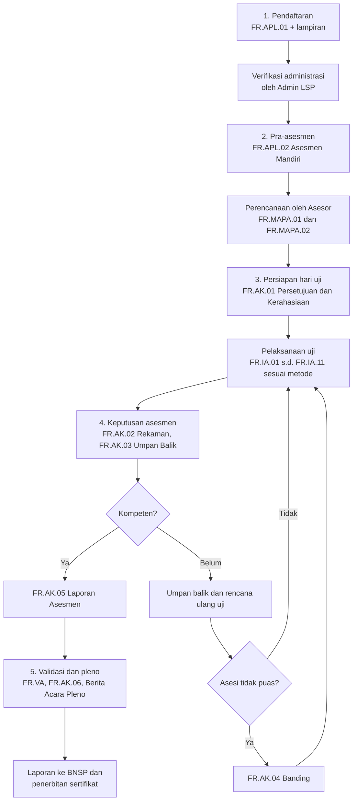

# Dokumentasi Alur Asesmen Uji Kompetensi BNSP

Dokumen ini merangkum alur asesmen kompetensi melalui LSP (Lembaga Sertifikasi Profesi) berlisensi BNSP. Setiap tahap dilengkapi dokumen yang masuk, formulir yang dipakai, dan dokumen yang dihasilkan. Bagian simulasi menerapkan alur tersebut pada tiga skema: menjahit pakaian dewasa, produktivitas SKKNI Level 5, dan digital marketing.

> **Catatan verifikasi.** Kode dan nama formulir mengikuti perangkat umum BNSP. Revisi pedoman dan skema tiap LSP bisa berbeda. Cocokkan dengan skema sertifikasi dan Materi Uji Kompetensi (MUK) milik LSP yang dipakai. Contoh unit kompetensi pada simulasi bersifat ilustrasi.

---

## 1. Pelaku dan Peran

| Pelaku | Peran |
|---|---|
| Asesi | Peserta uji kompetensi |
| Asesor Kompetensi | Merencanakan, melaksanakan, dan memutuskan hasil asesmen |
| Admin / Sekretariat LSP | Menerima pendaftaran, verifikasi administrasi, dan arsip |
| Komite Teknis / Tim Validasi | Memvalidasi perangkat dan proses asesmen |
| Manajer Sertifikasi / Pleno LSP | Menetapkan keputusan sertifikasi |
| TUK (Tempat Uji Kompetensi) | Lokasi asesmen: tempat kerja, tempat kerja simulasi, atau lembaga pelatihan |
| BNSP | Menerima laporan dan menerbitkan blanko sertifikat |

---

## 2. Flowchart Alur Asesmen

---

## 3. Tabel Master: Tahap, Dokumen Masuk, Formulir, Dokumen Keluar

| No | Tahap | Aktivitas utama | Pelaku | Dokumen masuk | Formulir | Dokumen keluar |
|---|---|---|---|---|---|---|
| 1 | Pendaftaran | Asesi memilih skema dan mengisi data diri, pendidikan, dan pengalaman | Asesi, Admin LSP | KTP, ijazah, CV, surat keterangan kerja atau sertifikat pelatihan, pas foto, bukti pembayaran (jika ada) | FR.APL.01 | Berkas permohonan terverifikasi, status asesi terdaftar |
| 2 | Pra-asesmen: asesmen mandiri | Asesi menilai diri terhadap KUK dan melampirkan bukti | Asesi | Skema sertifikasi, daftar unit kompetensi, bukti portofolio | FR.APL.02 | Asesmen mandiri terisi, daftar bukti pendukung |
| 3 | Pra-asesmen: perencanaan | Asesor menelaah APL.02, menentukan pendekatan, metode, dan instrumen | Asesor | FR.APL.01, FR.APL.02, skema, MUK | FR.MAPA.01, FR.MAPA.02 | Rencana asesmen, peta instrumen per unit dan KUK |
| 4 | Persiapan hari uji | Asesor menjelaskan proses, hak, dan kerahasiaan, lalu asesi menyetujui | Asesor, Asesi | Jadwal uji, daftar hadir, bukti identitas | FR.AK.01 | Persetujuan asesmen dan kerahasiaan yang ditandatangani |
| 5 | Pelaksanaan uji | Asesor mengumpulkan bukti dengan metode terpilih | Asesor, Asesi | Instrumen FR.IA terpilih, perlengkapan TUK, lembar jawaban | FR.IA.01 s.d. FR.IA.11 | Instrumen terisi dan bukti (hasil kerja, lembar jawaban, rekaman) |
| 6 | Keputusan dan rekaman | Asesor menilai seluruh bukti, menetapkan K atau BK, memberi umpan balik | Asesor | Semua FR.IA terisi, bukti portofolio | FR.AK.02, FR.AK.03, FR.AK.05 | Rekaman asesmen, umpan balik, laporan asesmen |
| 7 | Banding (jika diajukan) | Asesi mengajukan banding atas keputusan | Asesi, LSP | FR.AK.02, FR.AK.03 | FR.AK.04 | Hasil tindak lanjut banding |
| 8 | Peninjauan proses | Asesor meninjau kesesuaian proses asesmen | Asesor, LSP | Seluruh rekaman asesmen | FR.AK.06 | Rekaman tinjauan proses |
| 9 | Validasi dan pleno | Validasi perangkat dan proses, penetapan keputusan sertifikasi | Komite Teknis, Pleno LSP | Laporan asesmen, rekap hasil | FR.VA | Berita Acara Pleno, daftar asesi kompeten |
| 10 | Pelaporan dan sertifikat | LSP melapor ke BNSP, sertifikat dicetak dan diserahkan | Admin LSP, BNSP | Berita Acara Pleno, daftar asesi kompeten | Surat pengantar blanko | Sertifikat kompetensi, laporan ke BNSP, arsip |

> Beberapa LSP juga memakai FR.AK.07 (penyesuaian yang wajar dan beralasan) untuk asesi yang membutuhkan penyesuaian. Gunakan hanya jika ada di perangkat LSP.

---

## 4. Katalog Formulir

### 4.1 Permohonan dan Perencanaan

| Kode | Nama | Diisi oleh |
|---|---|---|
| FR.APL.01 | Permohonan Sertifikasi Kompetensi | Asesi |
| FR.APL.02 | Asesmen Mandiri | Asesi, diverifikasi asesor |
| FR.MAPA.01 | Merencanakan Aktivitas dan Proses Asesmen | Asesor |
| FR.MAPA.02 | Peta Instrumen Asesmen (hubungan KUK dan instrumen) | Asesor |

### 4.2 Instrumen Asesmen (FR.IA)

| Kode | Nama | Metode |
|---|---|---|
| FR.IA.01 | Ceklis Observasi Aktivitas di Tempat Kerja atau Tempat Kerja Simulasi | Observasi |
| FR.IA.02 | Tugas Praktik Demonstrasi | Demonstrasi |
| FR.IA.03 | Pertanyaan untuk Mendukung Observasi | Lisan pendukung |
| FR.IA.04A | Penjelasan Singkat Proyek Terkait Pekerjaan atau Kegiatan Terstruktur Lainnya | Studi kasus, proyek |
| FR.IA.04B | Daftar Pertanyaan Lisan (berdasarkan proyek) | Lisan |
| FR.IA.05A / 05B / 05C | Pertanyaan Tertulis Pilihan Ganda, Lembar Jawaban, Kunci Jawaban | Tertulis PG |
| FR.IA.06A / 06B | Pertanyaan Tertulis Esai, Kunci Jawaban | Tertulis esai |
| FR.IA.07 | Pertanyaan Lisan | Lisan |
| FR.IA.08 | Ceklis Verifikasi Portofolio | Portofolio |
| FR.IA.09 | Pertanyaan Wawancara | Wawancara |
| FR.IA.10 | Klarifikasi Bukti Pihak Ketiga | Bukti pihak ketiga |
| FR.IA.11 | Ceklis Meninjau Instrumen Asesmen | Tinjauan instrumen |

### 4.3 Keputusan, Rekaman, dan Validasi

| Kode | Nama |
|---|---|
| FR.AK.01 | Persetujuan Asesmen dan Kerahasiaan |
| FR.AK.02 | Rekaman Asesmen Kompetensi |
| FR.AK.03 | Umpan Balik dan Catatan Asesmen |
| FR.AK.04 | Banding Asesmen |
| FR.AK.05 | Laporan Asesmen |
| FR.AK.06 | Meninjau Proses Asesmen |
| FR.VA | Formulir Validasi Asesmen |

---

## 5. Simulasi 1: Skema Menjahit Pakaian Dewasa

**Karakter skema.** Kompetensi berbasis keterampilan praktik. Bukti utama adalah hasil kerja nyata dan cara kerja yang diamati.

| Item | Rincian |
|---|---|
| TUK | Workshop atau tempat kerja simulasi dengan mesin jahit, meja potong, dan setrika |
| Contoh unit kompetensi | Menyiapkan mesin jahit dan bahan, membuat pola, memotong bahan, menjahit komponen, finishing, K3 |
| Metode utama | Demonstrasi praktik dan observasi |
| Metode pendukung | Pertanyaan lisan, portofolio hasil jahitan sebelumnya |
| Durasi indikatif | Setengah sampai satu hari, tergantung jumlah unit |

### Dokumen yang disiapkan per tahap

| Tahap | Dokumen masuk (asesi) | Formulir | Dokumen keluar |
|---|---|---|---|
| Pendaftaran | KTP, ijazah atau surat keterangan, pas foto, foto hasil jahitan sebelumnya | FR.APL.01 | Berkas terverifikasi |
| Asesmen mandiri | Daftar KUK, foto portofolio, sertifikat pelatihan | FR.APL.02 | Daftar bukti yang diajukan |
| Perencanaan | Skema, MUK menjahit | FR.MAPA.01, MAPA.02 | Rencana asesmen dan peta instrumen |
| Hari uji | Alat jahit pribadi (jika diminta), bahan kain, pola | FR.AK.01 | Persetujuan asesmen |
| Praktik | Brief produk (misalnya kemeja atau rok dewasa), standar ukuran | FR.IA.01, FR.IA.02 | Produk jadi, ceklis observasi, tugas praktik terisi |
| Pendukung | Pertanyaan tentang kain, ukuran, K3 | FR.IA.03, FR.IA.07 | Jawaban lisan tercatat |
| Portofolio | Foto atau contoh jahitan terdahulu | FR.IA.08 | Ceklis verifikasi portofolio |
| Keputusan | Seluruh instrumen terisi | FR.AK.02, AK.03, AK.05 | Status K atau BK, umpan balik, laporan |
| Validasi | Rekap hasil | FR.VA, AK.06 | Berita Acara Pleno, sertifikat |

### Contoh Peta Instrumen (FR.MAPA.02)

| Unit | Observasi (IA.01) | Praktik (IA.02) | Lisan (IA.03 / IA.07) | Portofolio (IA.08) |
|---|---|---|---|---|
| Membuat pola | | v | v | v |
| Memotong bahan | v | v | | |
| Menjahit komponen | v | v | v | v |
| Finishing | v | v | | v |
| K3 dan kebersihan area | v | | v | |

---

## 6. Simulasi 2: Produktivitas SKKNI Level 5

**Karakter skema.** Kompetensi manajerial dan analitis. Bukti utama adalah analisis studi kasus, paparan, dan tanya jawab. Format ini sama dengan asesmen yang memakai FR.IA.04A.

| Item | Rincian |
|---|---|
| TUK | Ruang asesmen, sewaktu atau di lokasi lembaga, dengan tim asesor |
| Kelompok pekerjaan | (1) Merencanakan Peningkatan Produktivitas, (2) Melaksanakan Peningkatan Produktivitas, (3) Peningkatan Produktivitas Berkelanjutan Jangka Panjang |
| Metode utama | Studi kasus atau proyek terstruktur (FR.IA.04A) dengan paparan |
| Metode pendukung | Tanya jawab lisan (FR.IA.04B), verifikasi portofolio pengalaman |
| Contoh studi kasus | Usaha snack box dengan masalah efisiensi produksi, biaya, dan mutu |
| Waktu per kelompok pekerjaan | Mengerjakan 45 menit, presentasi 5 menit, tanya jawab 5 menit (total 55 menit) |

### Dokumen yang disiapkan per tahap

| Tahap | Dokumen masuk (asesi) | Formulir | Dokumen keluar |
|---|---|---|---|
| Pendaftaran | KTP, ijazah, CV, SK jabatan atau surat keterangan kerja, sertifikat pelatihan | FR.APL.01 | Berkas terverifikasi |
| Asesmen mandiri | Bukti pengalaman: laporan proyek produktivitas, data sebelum dan sesudah perbaikan | FR.APL.02 | Daftar bukti per unit |
| Perencanaan | Skema Level 5, MUK, studi kasus | FR.MAPA.01, MAPA.02 | Rencana asesmen per kelompok pekerjaan |
| Hari uji | Identitas, jadwal | FR.AK.01 | Persetujuan asesmen |
| Studi kasus | Soal kasus, lembar kerja, bahan paparan (digital atau tulisan tangan) | FR.IA.04A | Analisis dan rencana per kelompok pekerjaan, paparan |
| Tanya jawab | Pertanyaan asesor berdasarkan jawaban kasus | FR.IA.04B | Jawaban lisan tercatat |
| Portofolio | Laporan perbaikan produktivitas terdahulu | FR.IA.08 | Ceklis verifikasi portofolio |
| Keputusan | Semua instrumen terisi | FR.AK.02, AK.03, AK.05 | K atau BK per kelompok pekerjaan, umpan balik, laporan |
| Validasi | Rekap hasil | FR.VA, AK.06 | Berita Acara Pleno, sertifikat |

### Output yang diharapkan dari asesi per kelompok pekerjaan

| Kelompok pekerjaan | Isi jawaban yang dinilai |
|---|---|
| Planning | Diagnosis masalah, pengukuran baseline (indikator produktivitas), target, dan rencana perbaikan |
| Executing | Penerapan perbaikan, pembagian peran, pemantauan, dan pengendalian |
| Sustaining | Evaluasi hasil, standarisasi, budaya kerja, dan rencana perbaikan berkelanjutan |

---

## 7. Simulasi 3: Digital Marketing

**Karakter skema.** Kompetensi teknis berbasis komputer dan data. Bukti kuat berupa hasil kerja digital yang bisa diverifikasi.

| Item | Rincian |
|---|---|
| TUK | Laboratorium komputer atau tempat kerja dengan internet, akun uji, dan akses analytics |
| Contoh unit kompetensi | Menyusun strategi dan rencana digital marketing, membuat konten, optimasi SEO, mengelola iklan berbayar, mengelola media sosial, menganalisis dan melaporkan kinerja |
| Metode utama | Demonstrasi praktik di komputer, verifikasi portofolio |
| Metode pendukung | Tertulis (pilihan ganda atau esai), wawancara, klarifikasi bukti pihak ketiga (klien atau atasan) |
| Durasi indikatif | Setengah sampai satu hari |

### Dokumen yang disiapkan per tahap

| Tahap | Dokumen masuk (asesi) | Formulir | Dokumen keluar |
|---|---|---|---|
| Pendaftaran | KTP, ijazah, CV, tautan portofolio | FR.APL.01 | Berkas terverifikasi |
| Asesmen mandiri | Contoh campaign, laporan kinerja, tangkapan layar dashboard analytics | FR.APL.02 | Daftar bukti per unit |
| Perencanaan | Skema, MUK, daftar tugas praktik | FR.MAPA.01, MAPA.02 | Rencana asesmen dan peta instrumen |
| Hari uji | Identitas, akses akun uji | FR.AK.01 | Persetujuan asesmen |
| Praktik | Brief klien fiktif, akses tool (analytics, penjadwal konten, iklan) | FR.IA.01, FR.IA.02 | Content calendar, aset konten, setup campaign, ceklis observasi |
| Tertulis | Soal strategi dan istilah, kunci jawaban | FR.IA.05A/B/C atau FR.IA.06A/B | Lembar jawaban dan skor |
| Portofolio | Laporan campaign nyata, hasil SEO, data sebelum dan sesudah | FR.IA.08 | Ceklis verifikasi portofolio |
| Wawancara | Pertanyaan tentang keputusan strategi | FR.IA.09 | Jawaban tercatat |
| Pihak ketiga | Konfirmasi dari klien atau atasan | FR.IA.10 | Klarifikasi bukti pihak ketiga |
| Keputusan | Seluruh instrumen terisi | FR.AK.02, AK.03, AK.05 | K atau BK, umpan balik, laporan |
| Validasi | Rekap hasil | FR.VA, AK.06 | Berita Acara Pleno, sertifikat |

### Contoh Tugas Praktik (FR.IA.02)

| Tugas | Bukti yang dihasilkan |
|---|---|
| Menyusun rencana digital marketing 1 bulan untuk brief klien | Dokumen rencana, target KPI, pemilihan kanal |
| Membuat 3 aset konten dan jadwal unggah | File konten, content calendar |
| Melakukan optimasi on-page pada satu halaman contoh | Daftar perubahan, tangkapan layar sebelum dan sesudah |
| Membaca data analytics dan menyusun laporan singkat | Laporan temuan dan rekomendasi |

---

## 8. Perbandingan Tiga Skema

| Aspek | Menjahit Pakaian Dewasa | Produktivitas Level 5 | Digital Marketing |
|---|---|---|---|
| Sifat kompetensi | Keterampilan manual | Analitis dan manajerial | Teknis digital dan analitis |
| Bukti utama | Produk jahitan dan cara kerja | Analisis kasus dan paparan | Hasil kerja digital dan laporan |
| Instrumen dominan | FR.IA.01, IA.02, IA.03 | FR.IA.04A, IA.04B | FR.IA.02, IA.05/06, IA.08 |
| Instrumen pendukung | IA.07, IA.08 | IA.08 | IA.09, IA.10 |
| TUK | Workshop | Ruang asesmen | Lab komputer atau tempat kerja |
| Risiko umum BK | Ketepatan pola dan jahitan, K3 | Data tidak mendukung analisis, rencana tidak terukur | Bukti portofolio tidak bisa diverifikasi, KPI tidak jelas |

---

## 9. Matriks Dokumen Masuk dan Keluar (Ringkas)

| Tahap | Dokumen masuk | Dokumen keluar |
|---|---|---|
| Pendaftaran | Identitas, ijazah, CV, bukti pendukung | FR.APL.01 terverifikasi |
| Asesmen mandiri | Skema, bukti portofolio | FR.APL.02 |
| Perencanaan | FR.APL.01, FR.APL.02, MUK | FR.MAPA.01, FR.MAPA.02 |
| Hari uji | Jadwal, identitas | FR.AK.01 |
| Pelaksanaan | Instrumen FR.IA, perlengkapan TUK | FR.IA terisi, bukti kerja |
| Keputusan | Semua FR.IA | FR.AK.02, AK.03, AK.05 |
| Banding | FR.AK.02, AK.03 | FR.AK.04 |
| Validasi dan pleno | Laporan asesmen | FR.VA, FR.AK.06, Berita Acara Pleno |
| Pelaporan | Berita Acara Pleno | Sertifikat, laporan ke BNSP |

---

## 10. Ceklis Kesiapan Asesi

- [ ] Skema sertifikasi sudah dipilih dan dipahami
- [ ] FR.APL.01 dan lampiran lengkap
- [ ] FR.APL.02 terisi dengan bukti yang relevan dan valid
- [ ] Identitas asli dibawa pada hari uji
- [ ] Perlengkapan atau akses tool sesuai ketentuan TUK
- [ ] Paham hak banding dan prosesnya

## 11. Ceklis Kesiapan Asesor dan LSP

- [ ] MUK dan instrumen FR.IA sudah divalidasi
- [ ] FR.MAPA.01 dan MAPA.02 selesai sebelum hari uji
- [ ] TUK sudah diverifikasi dan sesuai skema
- [ ] FR.AK.01 ditandatangani sebelum uji dimulai
- [ ] Seluruh FR.IA, AK.02, AK.03, AK.05 terisi dan terarsip
- [ ] Pleno, laporan ke BNSP, dan penerbitan sertifikat terjadwal
