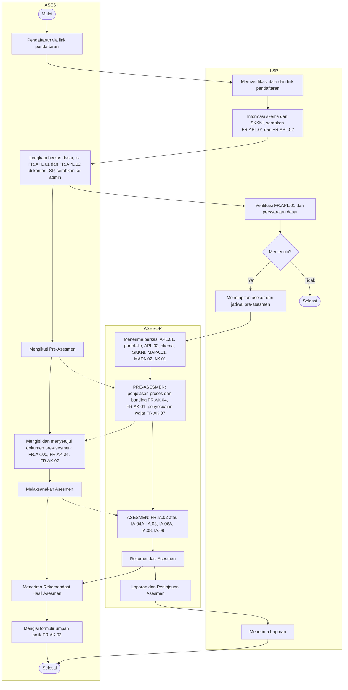

# Dokumentasi Alur Proses Uji Kompetensi BNSP (Versi Swimlane)

Dokumen ini mengikuti urutan pada bagan "Alur Proses Uji Kompetensi" dengan tiga jalur: **Asesi**, **LSP**, dan **Asesor**. Setiap langkah dilengkapi dokumen masuk, formulir, dan dokumen keluar. Bagian simulasi menerapkan alur yang sama pada tiga skema: menjahit pakaian dewasa, produktivitas SKKNI Level 5, dan digital marketing.

> **Catatan.**
> - Langkah 1 sampai 12 mengikuti bagan. Langkah bertanda **(+)** adalah tambahan dari pedoman umum BNSP yang tidak tergambar di bagan.
> - **Gerbang pre-asesmen:** seluruh dokumen pre-asesmen (FR.AK.01, FR.AK.04, FR.AK.07) harus diisi dan disetujui asesi sebelum asesmen dimulai.
> - **Umpan balik asesi:** setelah menerima rekomendasi asesmen, asesi wajib mengisi formulir umpan balik (FR.AK.03).
> - Pada bagan tertulis "FR.1A.09". Kode yang benar adalah **FR.IA.09** (Pertanyaan Wawancara).
> - Kode formulir dan instrumen yang dipakai bisa berbeda antar LSP dan revisi skema. Cocokkan dengan skema dan MUK LSP terkait. Contoh unit kompetensi pada simulasi bersifat ilustrasi.

---

## 1. Pelaku dan Peran

| Pelaku | Peran dalam bagan |
|---|---|
| Asesi | Mendaftar, melengkapi berkas dan formulir, mengikuti pre-asesmen dan asesmen, menerima rekomendasi hasil |
| LSP (Admin dan manajemen) | Memverifikasi data, memberi informasi skema dan SKKNI, memverifikasi persyaratan dasar, menetapkan asesor dan jadwal, menerima laporan |
| Asesor | Menerima berkas, melaksanakan pre-asesmen dan asesmen, membuat rekomendasi, laporan, dan peninjauan asesmen |

---

## 2. Flowchart Swimlane

---

## 3. Tabel Langkah, Dokumen Masuk, Formulir, dan Dokumen Keluar

| No | Pelaku | Langkah | Dokumen masuk | Formulir | Dokumen keluar |
|---|---|---|---|---|---|
| 1 | Asesi | Mulai dan mendaftar lewat link pendaftaran | Data diri, pilihan skema | Formulir daftar online | Data pendaftaran masuk ke LSP |
| 2 | LSP | Memverifikasi data yang masuk dari link pendaftaran | Data pendaftaran | Rekap pendaftar | Data terverifikasi awal |
| 3 | LSP | Memberi informasi skema dan SKKNI, menyerahkan formulir | Skema sertifikasi, SKKNI | FR.APL.01, FR.APL.02 (kosong) | Paket informasi dan formulir untuk asesi |
| 4 | Asesi | Melengkapi berkas persyaratan dasar, mengisi FR.APL.01 dan FR.APL.02 di kantor LSP, menyerahkan ke admin | KTP, ijazah, CV, surat keterangan kerja atau sertifikat pelatihan, pas foto, bukti portofolio | FR.APL.01, FR.APL.02 | Berkas permohonan lengkap |
| 5 | LSP | Verifikasi FR.APL.01 dan persyaratan dasar, lalu keputusan **memenuhi atau tidak** | Berkas asesi, persyaratan skema | FR.APL.01 | Status memenuhi atau tidak. Jika tidak memenuhi, proses **selesai** |
| 6 | LSP | Menetapkan asesor dan jadwal pre-asesmen | Daftar asesor, kalender TUK | Surat tugas asesor (+), jadwal | Penetapan asesor dan jadwal |
| 7 | Asesor | Menerima berkas: (1) FR.APL.01, (2) portofolio, (3) FR.APL.02, (4) skema sertifikasi, (5) SKKNI, (6) FR.MAPA.01, (7) FR.MAPA.02, (8) FR.AK.01 | Berkas dari LSP | FR.MAPA.01, FR.MAPA.02, FR.AK.01, FR.AK.07 (disiapkan untuk pre-asesmen) | Berkas asesmen siap dipelajari dan rencana asesmen |
| 8 | Asesi dan Asesor | **Pre-asesmen**: asesor menjelaskan tujuan, tata tertib, prinsip, metode, alat dan bahan asesmen, banding asesmen, serta penyesuaian yang wajar dan beralasan. **Asesi wajib mengisi dan menyetujui (menandatangani) seluruh dokumen pre-asesmen sebelum masuk ke asesmen** | Berkas langkah 7, identitas asli | FR.AK.01 (persetujuan asesmen dan kerahasiaan), FR.AK.04 (penjelasan banding), FR.AK.07 (penyesuaian yang wajar dan beralasan) | Seluruh dokumen pre-asesmen terisi dan disetujui asesi. Asesmen baru dimulai setelah ini |
| 9 | Asesi dan Asesor | **Asesmen**: pengumpulan bukti dengan metode terpilih | Dokumen pre-asesmen yang sudah disetujui asesi, instrumen FR.IA, perlengkapan TUK, lembar jawaban | FR.IA.02 atau FR.IA.04A, FR.IA.03, FR.IA.06A, FR.IA.08, FR.IA.09 | Instrumen terisi dan bukti kerja |
| 10 | Asesor | Membuat **Rekomendasi Asesmen** (Kompeten atau Belum Kompeten) dan umpan balik | Seluruh instrumen terisi | FR.AK.02 (+), FR.AK.03 (+, bagian catatan asesor) | Rekomendasi hasil, rekaman, umpan balik |
| 11 | Asesi | Menerima rekomendasi hasil asesmen, lalu **wajib mengisi formulir umpan balik** | Rekomendasi asesor | FR.AK.03 (bagian umpan balik asesi) | FR.AK.03 terisi oleh asesi. Jika tidak puas dengan hasil, asesi dapat mengajukan banding lewat FR.AK.04 |
| 12 | Asesor | Menyusun **Laporan dan Peninjauan Asesmen** lalu menyerahkan ke LSP | Rekaman, rekomendasi, dan FR.AK.03 yang sudah diisi asesi | FR.AK.05 (+), FR.AK.06 (+) | Laporan asesmen |
| 13 | LSP | Menerima laporan | Laporan asesmen | Laporan asesmen | Laporan diterima dan diarsipkan |
| 14 | LSP (+) | Validasi, pleno, pelaporan ke BNSP, dan penerbitan sertifikat | Laporan asesmen, rekap hasil | FR.VA, Berita Acara Pleno, surat pengantar blanko | Sertifikat kompetensi bagi asesi Kompeten |
| 15 | Asesi | **Selesai** | Hasil akhir | | Sertifikat atau rencana uji ulang |

---

## 4. Katalog Formulir

### 4.1 Permohonan dan Perencanaan

| Kode | Nama | Langkah | Diisi oleh |
|---|---|---|---|
| FR.APL.01 | Permohonan Sertifikasi Kompetensi | 3, 4, 5 | Asesi |
| FR.APL.02 | Asesmen Mandiri | 3, 4 | Asesi, diverifikasi asesor |
| FR.MAPA.01 | Merencanakan Aktivitas dan Proses Asesmen | 7 | Asesor |
| FR.MAPA.02 | Peta Instrumen Asesmen | 7 | Asesor |

### 4.2 Pre-Asesmen dan Keputusan

| Kode | Nama | Langkah |
|---|---|---|
| FR.AK.01 | Persetujuan Asesmen dan Kerahasiaan | 7, 8 |
| FR.AK.04 | Banding Asesmen (dijelaskan saat pre-asesmen) | 8 |
| FR.AK.07 | Penyesuaian yang Wajar dan Beralasan (diisi dan disetujui saat pre-asesmen) | 8 |
| FR.AK.02 (+) | Rekaman Asesmen Kompetensi | 10 |
| FR.AK.03 (+) | Umpan Balik dan Catatan Asesmen (asesi wajib mengisi umpan balik setelah menerima rekomendasi) | 10, 11 |
| FR.AK.05 (+) | Laporan Asesmen | 12 |
| FR.AK.06 (+) | Meninjau Proses Asesmen | 12 |
| FR.VA (+) | Formulir Validasi Asesmen | 14 |

### 4.3 Instrumen Asesmen (FR.IA)

| Kode | Nama | Ada di bagan |
|---|---|---|
| FR.IA.01 | Ceklis Observasi Aktivitas | Tidak (opsional) |
| FR.IA.02 | Tugas Praktik Demonstrasi | Ya |
| FR.IA.03 | Pertanyaan untuk Mendukung Observasi | Ya |
| FR.IA.04A | Tugas Terstruktur / Penjelasan Singkat Proyek | Ya |
| FR.IA.04B | Daftar Pertanyaan Lisan (berdasarkan proyek) | Tidak (opsional) |
| FR.IA.05A/B/C | Pertanyaan Tertulis Pilihan Ganda, Lembar Jawaban, Kunci | Tidak (opsional) |
| FR.IA.06A/B | Pertanyaan Tertulis Esai, Kunci Jawaban | Ya (06A) |
| FR.IA.07 | Pertanyaan Lisan | Tidak (opsional) |
| FR.IA.08 | Ceklis Verifikasi Portofolio | Ya |
| FR.IA.09 | Pertanyaan Wawancara | Ya |
| FR.IA.10 | Klarifikasi Bukti Pihak Ketiga | Tidak (opsional) |
| FR.IA.11 | Ceklis Meninjau Instrumen Asesmen | Tidak (opsional) |

---

## 5. Simulasi 1: Skema Menjahit Pakaian Dewasa

| Item | Rincian |
|---|---|
| Sifat skema | Keterampilan praktik |
| TUK | Workshop dengan mesin jahit, meja potong, dan setrika |
| Contoh unit kompetensi | Menyiapkan mesin dan bahan, membuat pola, memotong bahan, menjahit komponen, finishing, K3 |
| Metode utama | Tugas praktik demonstrasi (FR.IA.02) |
| Metode pendukung | Pertanyaan mendukung observasi (FR.IA.03), verifikasi portofolio (FR.IA.08), observasi (FR.IA.01) bila dipakai LSP |

### Dokumen per langkah

| Langkah bagan | Dokumen masuk (asesi) | Formulir | Dokumen keluar |
|---|---|---|---|
| Pendaftaran (1 sampai 4) | KTP, ijazah atau surat keterangan, pas foto, foto hasil jahitan sebelumnya | FR.APL.01, FR.APL.02 | Berkas lengkap dengan daftar bukti portofolio |
| Verifikasi LSP (5 sampai 6) | Berkas asesi | FR.APL.01 | Status memenuhi, asesor dan jadwal ditetapkan |
| Berkas asesor (7) | Skema menjahit, SKKNI, portofolio | FR.MAPA.01, MAPA.02, AK.01, AK.07 | Rencana dan peta instrumen |
| Pre-asesmen (8) | Identitas asli | FR.AK.01, FR.AK.04, FR.AK.07 | Seluruh dokumen pre-asesmen diisi dan disetujui asesi sebelum asesmen |
| Asesmen (9) | Brief produk (kemeja atau rok dewasa), kain, pola, alat jahit | FR.IA.02, IA.03, IA.08 | Produk jadi, tugas praktik terisi, jawaban lisan, ceklis portofolio |
| Rekomendasi (10 sampai 11) | Semua instrumen | FR.AK.02, AK.03 (umpan balik wajib diisi asesi) | Rekomendasi K atau BK, FR.AK.03 terisi oleh asesi |
| Laporan (12 sampai 13) | Rekaman asesmen | FR.AK.05, AK.06 | Laporan asesmen ke LSP |
| Penutup (14 sampai 15) | Rekap hasil | FR.VA, Berita Acara Pleno | Sertifikat |

### Contoh Peta Instrumen (FR.MAPA.02)

| Unit | Praktik (IA.02) | Pertanyaan pendukung (IA.03) | Portofolio (IA.08) |
|---|---|---|---|
| Membuat pola | v | v | v |
| Memotong bahan | v | | |
| Menjahit komponen | v | v | v |
| Finishing | v | | v |
| K3 dan kebersihan area | v | v | |

---

## 6. Simulasi 2: Produktivitas SKKNI Level 5

| Item | Rincian |
|---|---|
| Sifat skema | Analitis dan manajerial |
| TUK | Ruang asesmen dengan tim asesor |
| Kelompok pekerjaan | (1) Merencanakan Peningkatan Produktivitas, (2) Melaksanakan Peningkatan Produktivitas, (3) Peningkatan Produktivitas Berkelanjutan Jangka Panjang |
| Metode utama | Tugas terstruktur / studi kasus (FR.IA.04A) dengan paparan |
| Metode pendukung | Pertanyaan mendukung observasi (FR.IA.03), esai (FR.IA.06A), portofolio (FR.IA.08), wawancara (FR.IA.09) |
| Waktu per kelompok pekerjaan | Mengerjakan 45 menit, presentasi 5 menit, tanya jawab 5 menit (total 55 menit) |

### Dokumen per langkah

| Langkah bagan | Dokumen masuk (asesi) | Formulir | Dokumen keluar |
|---|---|---|---|
| Pendaftaran (1 sampai 4) | KTP, ijazah, CV, SK jabatan atau surat keterangan kerja, sertifikat pelatihan | FR.APL.01, FR.APL.02 | Berkas lengkap dengan bukti pengalaman |
| Verifikasi LSP (5 sampai 6) | Berkas asesi | FR.APL.01 | Status memenuhi, asesor dan jadwal |
| Berkas asesor (7) | Skema Level 5, SKKNI, portofolio, studi kasus | FR.MAPA.01, MAPA.02, AK.01, AK.07 | Rencana asesmen per kelompok pekerjaan |
| Pre-asesmen (8) | Identitas asli | FR.AK.01, FR.AK.04, FR.AK.07 | Seluruh dokumen pre-asesmen diisi dan disetujui asesi sebelum asesmen |
| Asesmen (9) | Soal studi kasus, lembar kerja, bahan paparan (digital atau tulisan tangan) | FR.IA.04A, IA.03, IA.06A, IA.08, IA.09 | Analisis per kelompok pekerjaan, paparan, jawaban tanya jawab, ceklis portofolio |
| Rekomendasi (10 sampai 11) | Semua instrumen | FR.AK.02, AK.03 (umpan balik wajib diisi asesi) | Rekomendasi K atau BK per kelompok pekerjaan, FR.AK.03 terisi oleh asesi |
| Laporan (12 sampai 13) | Rekaman asesmen | FR.AK.05, AK.06 | Laporan asesmen ke LSP |
| Penutup (14 sampai 15) | Rekap hasil | FR.VA, Berita Acara Pleno | Sertifikat |

### Isi jawaban yang dinilai per kelompok pekerjaan

| Kelompok pekerjaan | Isi jawaban |
|---|---|
| Planning | Diagnosis masalah, baseline indikator produktivitas, target, rencana perbaikan |
| Executing | Penerapan perbaikan, pembagian peran, pemantauan, pengendalian |
| Sustaining | Evaluasi hasil, standarisasi, budaya kerja, perbaikan berkelanjutan |

---

## 7. Simulasi 3: Digital Marketing

| Item | Rincian |
|---|---|
| Sifat skema | Teknis digital dan analitis |
| TUK | Lab komputer atau tempat kerja dengan internet dan akun uji |
| Contoh unit kompetensi | Rencana digital marketing, pembuatan konten, SEO, iklan berbayar, media sosial, analisis dan pelaporan kinerja |
| Metode utama | Tugas praktik demonstrasi di komputer (FR.IA.02) |
| Metode pendukung | Pertanyaan mendukung observasi (FR.IA.03), esai (FR.IA.06A), portofolio (FR.IA.08), wawancara (FR.IA.09); klarifikasi pihak ketiga (FR.IA.10) bila dipakai LSP |

### Dokumen per langkah

| Langkah bagan | Dokumen masuk (asesi) | Formulir | Dokumen keluar |
|---|---|---|---|
| Pendaftaran (1 sampai 4) | KTP, ijazah, CV, tautan portofolio | FR.APL.01, FR.APL.02 | Berkas lengkap dengan contoh campaign dan laporan kinerja |
| Verifikasi LSP (5 sampai 6) | Berkas asesi | FR.APL.01 | Status memenuhi, asesor dan jadwal |
| Berkas asesor (7) | Skema, SKKNI, portofolio | FR.MAPA.01, MAPA.02, AK.01, AK.07 | Rencana dan peta instrumen |
| Pre-asesmen (8) | Identitas asli, akses akun uji | FR.AK.01, FR.AK.04, FR.AK.07 | Seluruh dokumen pre-asesmen diisi dan disetujui asesi sebelum asesmen |
| Asesmen (9) | Brief klien fiktif, akses tool analytics, penjadwal konten, dan iklan | FR.IA.02, IA.03, IA.06A, IA.08, IA.09 | Rencana digital marketing, content calendar, aset konten, laporan analytics, jawaban esai dan wawancara, ceklis portofolio |
| Rekomendasi (10 sampai 11) | Semua instrumen | FR.AK.02, AK.03 (umpan balik wajib diisi asesi) | Rekomendasi K atau BK, FR.AK.03 terisi oleh asesi |
| Laporan (12 sampai 13) | Rekaman asesmen | FR.AK.05, AK.06 | Laporan asesmen ke LSP |
| Penutup (14 sampai 15) | Rekap hasil | FR.VA, Berita Acara Pleno | Sertifikat |

### Contoh Tugas Praktik (FR.IA.02)

| Tugas | Bukti yang dihasilkan |
|---|---|
| Menyusun rencana digital marketing 1 bulan untuk brief klien | Dokumen rencana, KPI, pemilihan kanal |
| Membuat 3 aset konten dan jadwal unggah | File konten, content calendar |
| Optimasi on-page satu halaman contoh | Daftar perubahan, tangkapan layar sebelum dan sesudah |
| Membaca data analytics dan menyusun laporan singkat | Laporan temuan dan rekomendasi |

---

## 8. Perbandingan Instrumen Tahap Asesmen (Langkah 9)

| Instrumen | Menjahit | Produktivitas Level 5 | Digital Marketing |
|---|---|---|---|
| FR.IA.02 Tugas praktik demonstrasi | Utama | | Utama |
| FR.IA.04A Tugas terstruktur | | Utama | |
| FR.IA.03 Pertanyaan mendukung observasi | Ya | Ya | Ya |
| FR.IA.06A Esai | | Ya | Ya |
| FR.IA.08 Verifikasi portofolio | Ya | Ya | Ya |
| FR.IA.09 Wawancara | Opsional | Ya | Ya |
| Bukti utama | Produk jahitan | Analisis dan paparan | Hasil kerja digital |
| Risiko umum BK | Ketepatan pola dan jahitan, K3 | Analisis tidak didukung data, rencana tidak terukur | Portofolio tidak terverifikasi, KPI tidak jelas |

---

## 9. Ceklis per Pelaku

### Asesi
- [ ] Mendaftar lewat link pendaftaran dengan data benar
- [ ] FR.APL.01 dan FR.APL.02 terisi, berkas persyaratan dasar lengkap
- [ ] Bukti portofolio valid dan relevan dengan skema
- [ ] Hadir pada jadwal pre-asesmen dengan identitas asli
- [ ] Mengisi dan menyetujui seluruh dokumen pre-asesmen (FR.AK.01, FR.AK.04, FR.AK.07) sebelum asesmen
- [ ] Mengisi formulir umpan balik (FR.AK.03) setelah menerima rekomendasi asesmen

### LSP
- [ ] Data pendaftaran diverifikasi, informasi skema dan SKKNI diberikan
- [ ] FR.APL.01 dan persyaratan dasar diverifikasi, keputusan memenuhi atau tidak tercatat
- [ ] Asesor dan jadwal pre-asesmen ditetapkan
- [ ] Laporan asesmen diterima, divalidasi, dan dilaporkan ke BNSP

### Asesor
- [ ] Delapan berkas diterima dan dipelajari
- [ ] Pre-asesmen dilaksanakan, FR.AK.01, FR.AK.04, dan FR.AK.07 diisi dan disetujui asesi sebelum asesmen dimulai
- [ ] Penyesuaian wajar dan beralasan (FR.AK.07) dicatat bila asesi membutuhkan
- [ ] Instrumen FR.IA terisi sesuai peta instrumen
- [ ] Rekomendasi asesmen dibuat dan asesi mengisi FR.AK.03, lalu laporan dan peninjauan asesmen diserahkan ke LSP
