# System Design Document

## Aplikasi SiapKompeten— Sistem Informasi Lembaga Sertifikasi Profesi

| Atribut         | Isi                                                                      |
| --------------- | ------------------------------------------------------------------------ |
| Nama Aplikasi   | SiapKompeten                                                             |
| Dokumen         | System Design (arsitektur, data, UI, keamanan, implementasi)             |
| Versi           | 1.2 (Draft)                                                              |
| Tanggal         | 31 Oktober 2026                                                          |
| Author          | **Muhamad Arya Kurniawan**                                         |
| Dokumen Terkait | `BRD_Aplikasi_LSPKU.md` (ID kebutuhan FR-xxx / BR-xxx dirujuk di sini) |
| Referensi       | Buku Panduan SILSP Asesor dan Administrator (Dhega Febiharsa)            |
| Stack           | Laravel, MySQL, UUID, Tabler UI (https://docs.tabler.io/ui)              |

### Riwayat Revisi

| Versi | Tanggal     | Perubahan                                                                                                | Author                 |
| ----- | ----------- | -------------------------------------------------------------------------------------------------------- | ---------------------- |
| 1.0   | 30 Okt 2026 | Penyusunan lengkap: arsitektur, model data, state machine, route, keamanan, implementasi                | Muhamad Arya Kurniawan |
| 1.1   | 30 Okt 2026 | Kesiapan multitenancy (bagian 4.2, klasifikasi tabel, pengujian tenant)                                  | Muhamad Arya Kurniawan |
| 1.2   | 31 Okt 2026 | **(Revisi multi-LSP)** identitas global vs keanggotaan per LSP: `asesor_profiles`/`asesor_institutions`/`asesor_kompetensis`, `asesi_profiles`/`asesi_institutions`, undangan asesor, consent dokumen, cek bentrok lintas LSP, RBAC teams | Muhamad Arya Kurniawan |

---

## 1. Ringkasan Arsitektur

LSPKU dibangun sebagai **modular monolith**: satu aplikasi Laravel dengan pemisahan modul berdasarkan domain, tiga portal berbasis peran (Admin, Asesor, Asesi), dan satu situs publik (CMS). Pemrosesan berat (notifikasi, PDF, impor) dijalankan asinkron lewat queue.

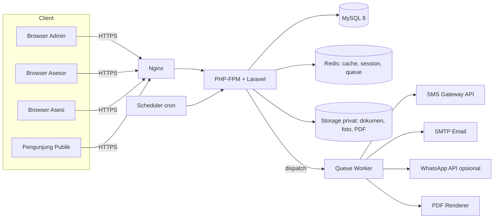

### 1.1 Prinsip Desain

| Prinsip                 | Penerapan                                                                     |
| ----------------------- | ----------------------------------------------------------------------------- |
| Single source of truth  | Data LSP, skema, dan biaya dirujuk seluruh portal (BR-RULE-19)                |
| Pemisahan domain        | Folder `app/Domain/*` per modul; controller tipis, logika di Action/Service |
| UUID di mana-mana       | Primary key dan foreign key UUID; route model binding via UUID                |
| Aman secara default     | Policy per resource, berkas privat, audit log                                 |
| Asinkron untuk I/O luar | SMS/Email/PDF/Impor lewat queue; UI tidak menunggu                            |
| Immutable setelah final | Hasil asesmen final dikunci (BR-RULE-21)                                      |
| Isolasi tenant          | Setiap tabel operasional memiliki `institution_id`; scope + policy + uji lintas tenant (bagian 4.2) |

---

## 2. Stack Teknologi

| Lapisan             | Pilihan                                                                                         | Catatan                                                        |
| ------------------- | ----------------------------------------------------------------------------------------------- | -------------------------------------------------------------- |
| Bahasa              | PHP 8.4+                                                                                        | Wajib 8.4.1+ (platform check Composer)                         |
| Framework           | **Laravel** (versi stabil terbaru saat proyek dimulai)                                    | Pastikan memeriksa persyaratan PHP versi tersebut              |
| Database            | **MySQL 8.0+** (InnoDB, utf8mb4)                                                          | Opsi MariaDB 10.6+                                             |
| UI                  | **Tabler** (`@tabler/core`), Bootstrap 5 based                                          | Instal via npm + Vite                                          |
| Rendering           | Blade murni + HTML/CSS + Alpine.js ringan (tanpa Livewire)                                | Form POST/redirect/GET; interaksi kompleks menyusul                         |
| Autentikasi         | Laravel Fortify/Breeze (headless) + guard session                                               | Tampilan login memakai halaman autentikasi Tabler              |
| Otorisasi           | `spatie/laravel-permission` + Laravel Policy                                                  | Konfigurasi UUID pada migrasi pivot                            |
| Audit               | `spatie/laravel-activitylog`                                                                  | Subjek/causer UUID                                             |
| Excel               | `maatwebsite/excel`                                                                           | Impor asesi, ekspor laporan                                    |
| PDF                 | `barryvdh/laravel-dompdf` (atau `spatie/laravel-pdf`/Browsershot bila perlu presisi tinggi) | Template Blade A4                                              |
| Media/Upload        | Filesystem Laravel disk `private` (+ opsional S3-compatible)                                  | URL bertanda tangan (signed URL)                               |
| QR                  | `simplesoftwareio/simple-qrcode`                                                              | Sertifikat                                                     |
| Queue/Cache/Session | Redis (opsi: database driver untuk instalasi kecil)                                             | Supervisor menjalankan worker                                  |
| Test                | Pest + Laravel Dusk (opsional)                                                                  | Cakupan fitur kritis                                           |
| Kualitas kode       | Laravel Pint, Larastan                                                                          | CI                                                             |
| Deploy              | Nginx, PHP-FPM, Supervisor, cron scheduler                                                      | Docker Compose untuk dev                                       |

---

## 3. Struktur Modul dan Folder

```
app/
├── Domain/
│   ├── Setup/           # app_settings, wizard
│   ├── Lsp/             # Lsp, Tuk, RekeningBank
│   ├── Standar/         # Skknis, Skema, Persyaratan, Unit, Elemen, Kuk
│   ├── Jadwal/          # EventAsesmen, JadwalAsesmen, Presensi
│   ├── Asesi/           # Asesi, DokumenPokok, ImportAsesi
│   ├── Asesor/          # Asesor
│   ├── Pendaftaran/     # Pendaftaran, DokumenPersyaratan, Verifikasi
│   ├── Pembayaran/      # Biaya, Pembayaran
│   ├── Asesmen/         # Apl02, HasilAsesmen (MAK-02)
│   ├── Formulir/        # Generator PDF
│   ├── Notifikasi/      # Outbox, Inbox, Channel adapters
│   ├── Sertifikat/
│   └── Cms/
├── Enums/               # Status, JenisStandar, Keputusan, dll.
├── Http/
│   ├── Controllers/{Admin,Asesor,Asesi,Publik}/
│   ├── Middleware/      # EnsureRole, SetupCompleted, EnsureNotBlocked, EnsureTenantContext
├── Policies/
├── Support/             # Helpers, UuidV7, Terbilang, Wilayah
├── Services/          # InstitutionStorage (unggahan per tenant)
│   └── Traits/         # BelongsToTenant, TenantAwareJob, TenantAwareCommand
resources/views/
├── layouts/{admin,asesor,asesi,public,auth}.blade.php
├── components/tabler/   # card, stat, badge-status, table, modal, empty
└── pdf/{apl01,apl02,mak01,mak02,mak03,presensi,sertifikat}.blade.php
```

Setiap modul memiliki: `Models`, `Actions` (use-case, mis. `ApprovePendaftaran`), `Services`, `DTOs`, `Events/Listeners`.

---

## 4. Strategi UUID dan Multitenancy

### 4.1 UUID v7

| Keputusan          | Pilihan                                                                                        | Alasan                                                                      |
| ------------------ | ---------------------------------------------------------------------------------------------- | --------------------------------------------------------------------------- |
| Versi UUID         | **UUID v7** (terurut waktu), dihasilkan trait `HasUuids` Laravel                       | Mengurangi fragmentasi indeks B-Tree dibanding v4                           |
| Tipe kolom MySQL   | `CHAR(36)` via `$table->uuid()` / `foreignUuid()`                                        | Sederhana, mudah debug; alternatif `BINARY(16)` bila ukuran indeks kritis |
| Primary key        | `id` UUID pada **semua** tabel (termasuk pivot yang punya data sendiri)                | NFR-03                                                                      |
| Foreign key        | `foreignUuid('x_id')->constrained()` dengan aturan `restrictOnDelete` untuk data referensi | BR-RULE-20                                                                  |
| URL                | `/admin/asesi/{asesi}` dengan route model binding UUID                                       | Tidak ada ID berurutan (AC-09)                                              |
| Pengurutan         | Urut default `id` (v7 = kronologis) atau `created_at`                                      |                                                                             |
| Kolom nomor bisnis | Terpisah dari UUID: `no_pendaftaran`, `kode_skema`, `no_sertifikat`, `nik`             | UUID bukan nomor yang dibaca manusia                                        |

**Contoh model dasar**

```php
<?php

namespace App\Domain\Standar\Models;

use Illuminate\Database\Eloquent\Concerns\HasUuids;
use Illuminate\Database\Eloquent\Factories\HasFactory;
use Illuminate\Database\Eloquent\Model;
use Illuminate\Database\Eloquent\SoftDeletes;

class Skema extends Model
{
    use HasFactory, HasUuids, SoftDeletes;

    protected $fillable = ['skkni_id', 'kode', 'nama', 'keterangan_bukti', 'is_aktif'];

    protected $casts = ['is_aktif' => 'boolean'];

    public function skkni()   { return $this->belongsTo(Skkni::class); }
    public function persyaratans() { return $this->hasMany(SkemaPersyaratan::class); }
    public function units()   { return $this->hasMany(UnitKompetensi::class); }
}
```

**Contoh migrasi**

```php
Schema::create('skemas', function (Blueprint $table) {
    $table->uuid('id')->primary();
    $table->foreignUuid('skkni_id')->constrained('skknis')->restrictOnDelete();
    $table->string('kode', 50)->unique();
    $table->string('nama');
    $table->text('keterangan_bukti')->nullable();
    $table->boolean('is_aktif')->default(true);
    $table->timestamps();
    $table->softDeletes();
});
```

> Untuk `spatie/laravel-permission` dan `activitylog`, sesuaikan migrasi bawaan agar `model_id`/`subject_id`/`causer_id` bertipe `uuid` (gunakan `uuidMorphs`).

### 4.2 Multitenancy: Partisi Data per Lembaga (Tenant)

**Keputusan**: satu database, satu set tabel (*shared schema*), isolasi baris berdasarkan kolom `institution_id`. Setiap baris pada tabel `institutions` adalah satu tenant (satu Lembaga Sertifikasi Profesi). MVP hanya berisi satu LSP, tetapi skema, trait, middleware, dan pengujian disiapkan sejak awal sehingga penambahan LSP berikutnya tidak memerlukan migrasi ulang.

**Model akses**: **satu domain, tenant berbasis sesi (context/session)**. Tidak ada subdomain, domain kustom, atau path `/platform` pada MVP. Setelah login, middleware menetapkan `session('active_institution_id')`; seluruh query model tenant-scoped otomatis difilter dari nilai sesi tersebut. Pengguna yang terhubung ke lebih dari satu lembaga dapat berpindah lewat *tenant switcher* di `<x-header />` (`POST /tenant/switch`), dan server memverifikasi keanggotaan sebelum mengubah sesi.

**Model identitas dan keanggotaan (Revisi multi-LSP)**: *identitas orang itu global; keanggotaan, peran, dan data operasional itu per LSP*.

| Lapisan                                     | Cakupan     | Isi                                                                                                            |
| ------------------------------------------- | ----------- | -------------------------------------------------------------------------------------------------------------- |
| Akun (`users`)                              | **Global**  | login, NIK (terenkripsi + `nik_hash` **UNIQUE global**), email, phone, password, status akun                   |
| Keanggotaan (`institution_user`)            | Per LSP     | `institution_id`, `user_id`, `role`, `status` (`diundang`,`aktif`,`nonaktif`), unique `(institution_id,user_id,role)` |
| Profil asesor (`asesor_profiles`)           | **Global**  | data pribadi, pendidikan, bidang keahlian, foto, `no_register` BNSP (No. MET) dan masa berlaku sertifikat asesor |
| Asesor di LSP (`asesor_institutions`)       | Per LSP     | `institution_id`, `asesor_profile_id`, no. SK/kontrak/surat tugas, `lisensi_berlaku_hingga`, status, `joined_at` |
| Lingkup asesor (`asesor_kompetensis`)       | Per LSP     | `asesor_institution_id`, `skema_id` (opsional `unit_id`), masa berlaku                                          |
| Profil asesi (`asesi_profiles`)             | **Global**  | data pribadi dasar (nama, TTL, alamat, pendidikan, foto)                                                        |
| Asesi di LSP (`asesi_institutions`)         | Per LSP     | `institution_id`, `asesi_profile_id`, `no_registrasi`, `status_verifikasi`, `status_kompetensi`, `sumber`, `import_batch_id` |
| Data operasional (dokumen, pendaftaran, pembayaran, APL-02, hasil, sertifikat) | Per LSP | Merujuk `asesi_institution_id` / `asesor_institution_id`, bukan profil global                    |
| Penugasan (`jadwal_asesors`)                | Per LSP     | Merujuk `asesor_institution_id` (bukan profil global), `peran` tetap                                            |

Aturan bisnis lengkap (10 butir) tercantum pada BRD bagian 6 sebagai **BR-RULE-22..31**; bagian ini hanya menjelaskan penerapannya di skema dan kode.

**Stack UI**: Blade murni + form HTML/CSS (tanpa Livewire, tanpa Vite pada fondasi ini). Semua perubahan state tenant terjadi lewat request HTTP biasa (POST/redirect/GET), sehingga otorisasi tetap di server.

| Pendekatan             | Kekuatan isolasi | Biaya operasional | Cocok untuk        | Keputusan |
| ---------------------- | ---------------- | ----------------- | ------------------ | --------- |
| Database per tenant    | Sangat kuat      | Tinggi (N migrasi, N backup) | Puluhan tenant besar | Tidak     |
| Schema per tenant      | Kuat             | Sedang–tinggi     | Puluhan tenant     | Tidak     |
| **Shared schema + `institution_id`** | Sedang–kuat (aplikasi + constraint) | Rendah | Ratusan tenant | **Dipilih** |

#### 4.2.1 Klasifikasi Tabel

| Kelompok            | Tabel                                                                                                                                                                                                                                                                                                            | Aturan                                                                                                                                        |
| ------------------- | ---------------------------------------------------------------------------------------------------------------------------------------------------------------------------------------------------------------------------------------------------------------------------------------------------------------- | --------------------------------------------------------------------------------------------------------------------------------------------- |
| Global / platform   | `institutions` (root tenant), `provinces`, `cities`, `districts`, `roles`, `permissions`, **`asesor_profiles`**, **`asesi_profiles`** (Revisi multi-LSP), `jobs`, `failed_jobs`, `cache`, `sessions`                        | Tanpa `institution_id`; `institutions.id` menjadi identitas tenant; profil orang bersifat global |
| Tenant-scoped       | `users` (nullable untuk platform), **`institution_user`**, `app_settings`, `tuks`, `rekening_banks`, `skknis`, `skemas`, `skema_persyaratans`, `skema_units`, `unit_kompetensis`, `elemen_kompetensis`, `kriteria_unjuk_kerjas`, `biayas`, **`asesor_institutions`**, **`asesor_kompetensis`**, **`asesi_institutions`**, **`asesor_invitations`**, **`document_consents`** (Revisi multi-LSP), `import_batches`, `import_rows`, `event_asesmens`, `jadwal_asesmens`, `jadwal_asesors`, `pendaftarans`, `pendaftaran_dokumens`, `pembayarans`, `apl02_penilaians`, `apl02_jawabans`, `hasil_asesmens`, `hasil_asesmen_kuks`, `hasil_asesmen_units`, `hasil_asesmen_metodes`, `sertifikats`, `notifikasis`, `sms_masuks`, `notification_templates`, `cms_kontens`, `activity_log` | Wajib `institution_id` NOT NULL + FK `restrictOnDelete`; `users.institution_id` nullable hanya untuk Super Admin platform |

**Revisi multi-LSP:** tabel `asesors` dan `asesis` lama (satu baris per orang, terikat satu tenant) dipecah menjadi **profil global** + **keanggotaan per LSP** (`asesor_profiles` → `asesor_institutions`, `asesi_profiles` → `asesi_institutions`). Seluruh data operasional kini merujuk baris keanggotaan, bukan orangnya, sehingga satu orang dapat melayani banyak LSP tanpa duplikasi identitas. Rincian kolom pada bagian 5.2.

Tabel anak (`jadwal_asesors`, `pendaftaran_dokumens`, `apl02_jawabans`, `hasil_asesmen_*`) tetap menyimpan `institution_id` sebagai denormalisasi terkendali agar scope, indeks, dan audit konsisten. Nilainya wajib sama dengan parent dan divalidasi di Action serta (opsional) FK komposit.

#### 4.2.2 Komponen Implementasi

| Komponen                            | Tanggung jawab                                                                                                                                       |
| ----------------------------------- | ---------------------------------------------------------------------------------------------------------------------------------------------------- |
| `App\Support\TenantContext`         | Sumber tunggal konteks tenant: `id()`, `requireId()`, `set(Institution)`, `clear()`; membaca/menulis `active_institution_id`, `active_institution_name`, `active_institution_logo` di sesi |
| `BelongsToTenant` (trait model)     | Global scope `tenant` (`where institution_id = context`, **fail closed** `1 = 0` bila konteks kosong), auto-isi `institution_id` saat `creating`, tolak perubahan `institution_id` saat `updating`, plus `scopeForInstitution()` dan `withoutTenantScope()` |
| Middleware `EnsureTenantContext`     | Didaftarkan pada grup `web` dan alias `tenant.context`. Setelah login: pastikan sesi tenant terisi, validasi keanggotaan masih aktif, fallback ke `users.institution_id` lalu lembaga pertama; logout paksa bila tidak ada lembaga aktif |
| `InstitutionStorage`                | Menyimpan unggahan ke `uploads/{institution_id}/{uuid}.{ext}` melalui `Storage::disk('public')->putFileAs()` (pemisah path ditangani Laravel, aman untuk Windows/Linux) |
| Policy `InstitutionDocumentPolicy`  | `view`/`download` hanya bila dokumen milik lembaga yang dapat diakses user dan lembaga masih aktif; pelanggaran → 404 |
| Tenant switcher (`<x-header />`)    | Menampilkan nama/logo lembaga aktif dari sesi; dropdown `POST /tenant/switch` hanya muncul bila user punya akses >1 lembaga |
| Model pivot `institution_user`      | Daftar keanggotaan user ↔ lembaga (`role`, **`status` (`diundang`,`aktif`,`nonaktif`)**, timestamps) dengan unique `(institution_id, user_id, role)`; sumber kebenaran untuk `accessibleInstitutions()` (Revisi multi-LSP) |
| `AsesorInvitationService` (Revisi multi-LSP) | Mengundang asesor lintas LSP via NIK, memvalidasi keanggotaan, dan mengubah status keanggotaan (`diundang` → `aktif` / `ditolak`) |
| `CheckScheduleConflict` (Revisi multi-LSP) | Satu-satunya kelas yang boleh memakai `withoutTenantScope()` untuk mengecek bentrok jadwal lintas LSP; hanya mengembalikan status sibuk/tidak |
| Policy lintas-LSP (Revisi multi-LSP) | `AseorInstitutionPolicy` / `AsesiInstitutionPolicy`: keanggotaan aktif di LSP aktif, tanpa membocorkan data LSP lain |
| `TenantAwareJob` (belum diimplementasikan) | Serialisasi `institution_id`, re-bind context di `handle()`, lepas setelah selesai |
| `TenantAwareCommand` (belum diimplementasikan) | Perintah artisan wajib `--institution=` atau `--all-tenants`; tanpa itu gagal (fail closed) |

Catatan: `TenantContext` berbasis sesi, sehingga job/command yang berjalan di luar request HTTP **tidak** memiliki konteks otomatis. Semua job/command tenant wajib membawa `institution_id` eksplisit dan memanggil `TenantContext::set()` (atau `run()`) sebelum menyentuh model tenant-scoped.

#### 4.2.3 Aturan Pengisian dan Integritas

- `institution_id` diisi otomatis oleh trait; **tidak boleh** berasal dari input pengguna (`$fillable` tidak memuat `institution_id`).
- **Identitas global (Revisi multi-LSP)**: `users.nik_hash` dan `users.email` memakai **UNIQUE global** (satu NIK = satu akun di seluruh instalasi); duplikasi NIK ditolak di semua LSP. Penautan ke LSP baru selalu memakai akun yang sudah ada, bukan membuat akun baru.
- **Keanggotaan per LSP (Revisi multi-LSP)**: `institution_user` unique `(institution_id, user_id, role)`; keanggotaan dinonaktifkan (`status=nonaktif`), bukan dihapus, agar riwayat tetap utuh.
- **FK komposit (Revisi multi-LSP)**: relasi keanggotaan memakai FK komposit `(institution_id, *_institution_id)` — mis. `jadwal_asesors (institution_id, asesor_institution_id)`, `pendaftarans (institution_id, asesi_institution_id)` — sehingga penugasan LSP B mustahil menunjuk keanggotaan LSP A.
- Relasi antar entitas tenant wajib satu tenant. Validasi `exists` di FormRequest/Action selalu dibatasi `where('institution_id', $tenantId)`.
- Unique constraint memakai komposit `(institution_id, ...)`: `users.username`, `app_settings.key`, `tuks.kode`, `skknis.kode`, `skemas.kode`, `asesi_institutions.no_registrasi`, `asesor_institutions.no_sk` , `cms_kontens.slug`, `notification_templates.kode` (Revisi multi-LSP; `no_register` asesor kini global pada `asesor_profiles`).
- **Akun platform** (`users.institution_id = NULL`) tidak terlindungi unique komposit karena MySQL memperlakukan `NULL` sebagai nilai berbeda. Keunikan `username`/`email` platform ditegakkan dengan generated column (mis. `tenant_key = COALESCE(institution_id, 'platform')`) yang ikut dijadikan unique, atau validasi aplikasi + tabel `platform_users` terpisah. Pilih satu dan uji duplikasinya.
- Untuk tabel bernilai tinggi (`pendaftarans`, `hasil_asesmens`, `sertifikats`), tambahkan `unique(institution_id, id)` pada parent dan FK komposit `(institution_id, parent_id)`. Ini pertahanan berlapis agar baris anak tidak dapat menunjuk parent tenant lain meski terjadi bug aplikasi.
- Query lintas tenant hanya melalui `withoutTenantScope()`/`forInstitution()` yang eksplisit, dipakai seeder, perintah admin, dan pengujian; kode fitur biasa dilarang memakainya.
- Global scope tidak berlaku pada `institutions`; daftar lembaga yang boleh diakses user dibatasi `institution_user` (`accessibleInstitutions()`).

#### 4.2.4 Berkas, Cache, Queue, dan Scheduler

- **Berkas**: `uploads/{institution_id}/{uuid}.{ext}` pada disk `public` (privat dari web karena `storage:link` tidak dijalankan); unduhan hanya lewat route ber-otorisasi `GET /documents/{document}/download`. Path dibuat dengan `Storage::putFileAs()`/`DIRECTORY_SEPARATOR`, bukan konkatenasi slash/backslash manual.
- **Cache**: prefiks `t:{institution_id}:`; invalidasi saat data master tenant berubah.
- **Queue/Event**: job dan event membawa `institution_id`; listener me-restore context sebelum menulis. Job tanpa tenant yang valid masuk `failed_jobs`, bukan menulis data global.
- **Scheduler**: tugas berkala dijalankan per tenant aktif (pengingat lisensi, retry notifikasi, pembaruan status jadwal, pembersihan impor).

#### 4.2.5 Alur Sesi dan Routing

| Tahap            | Perilaku                                                                                                       |
| ---------------- | -------------------------------------------------------------------------------------------------------------- |
| Login            | `POST /login` (throttle 5/menit) → regenerasi sesi → pilih lembaga dari `accessibleInstitutions()` → `TenantContext::set()` |
| Request terjaga  | Middleware `EnsureTenantContext` memvalidasi sesi; sesi kedaluwarsa/dicabut → logout paksa + pesan galat      |
| Ganti lembaga    | `POST /tenant/switch` dengan `institution_id` (uuid); server cek keanggotaan, selain itu 403                   |
| Resource tenant  | Route model binding + global scope → resource lembaga lain tidak ditemukan (404)                                |
| Logout           | `TenantContext::clear()`, invalidasi sesi, regenerasi token CSRF                                              |

Tidak ada resolusi tenant dari domain/subdomain pada MVP. Penambahan domain per lembaga (jika dibutuhkan) dilakukan sebagai fase lanjutan tanpa mengubah skema `institution_id`.

#### 4.2.6 MVP vs Kesiapan Multi-LSP

- **MVP**: satu baris `institutions` utama, tetapi seeder menyiapkan dua lembaga + satu admin lintas lembaga agar switcher dan isolasi teruji. Trait dan `institution_id` aktif dengan mode strict (fail closed) sehingga tidak pernah ada data "tanpa tenant".
- **Menambah LSP kedua**: buat baris `institutions`, hubungkan user lewat `institution_user`, lalu impor master. Tanpa perubahan skema.
- **Fase lanjutan**: laporan konsolidasi, penagihan/langganan, kuota penyimpanan per tenant, dan (opsional) domain per lembaga.

#### 4.2.7 Pengujian Wajib

- Feature test (`tests/Feature/TenantIsolationTest.php`): user lembaga A membuka/mengunduh resource lembaga B → 404 (bukan 500 dan bukan data bocor); dashboard tidak menampilkan data lembaga B.
- Feature test: `creating` mengisi `institution_id` dari sesi; perubahan `institution_id` setelah dibuat → `LogicException`; unggahan tersimpan di `uploads/{institution_id}/`.
- Dusk (`tests/Browser/TenantIsolationTest.php`): login user lembaga A, dashboard hanya memuat lembaga A, akses URL dokumen dan unduhan lembaga B ditolak ("Not Found").
- Test unique komposit: kode sama boleh di tenant berbeda, ditolak di tenant yang sama; username platform duplikat ditolak.
- Test job/command tanpa context tenant gagal (fail closed) — wajib saat job/command tenant pertama ditambahkan.

**Pengujian wajib lintas LSP (Revisi multi-LSP):**

- Satu NIK = satu akun; asesor yang sama **aktif** di LSP A dan LSP B, dan tiap LSP hanya melihat data miliknya sendiri.
- Plotting asesor ke jadwal LSP C (belum menjadi anggota) **ditolak**.
- Asesor di luar lingkup skema (`asesor_kompetensis`) atau dengan sertifikat kedaluwarsa tidak dapat diplot.
- Bentrok jadwal LSP A vs LSP B terdeteksi tanpa membocorkan nama kegiatan, peserta, atau LSP lain (hanya status sibuk/tidak + tanggal/jam).
- Menonaktifkan keanggotaan di LSP B **tidak** mengubah status di LSP A; riwayat penugasan dan hasil tetap ada.
- Asesi di dua LSP: dokumen LSP A tidak terbaca di LSP B tanpa consent; pencabutan consent langsung berlaku.
- Admin LSP A membuka resource LSP B lewat URL → **404**.
- Peran berbeda per LSP (mis. asesor di A, admin di B) bekerja benar setelah tenant switch.
- Job/event/notifikasi membawa `institution_id` yang benar sesuai LSP asal kejadian.

---

## 5. Model Data

### 5.1 ERD (Domain Inti)

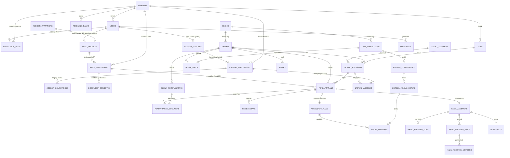

> **Multitenancy:** seluruh entitas operasional memiliki `institution_id` → `institutions` sebagai penanda tenant. Garis relasi tenant tidak digambar satu per satu agar ERD tetap terbaca; aturan lengkap ada pada bagian 4.2.
>
> **(Revisi multi-LSP):** orang (`ASESOR_PROFILES`, `ASESI_PROFILES`) bersifat **global**; keanggotaan (`ASESOR_INSTITUTIONS`, `ASESI_INSTITUTIONS`, `INSTITUTION_USER`) dan lingkup (`ASESOR_KOMPETENSIS`) bersifat **per LSP**. Seluruh entitas operasional (dokumen, pendaftaran, pembayaran, APL-02, hasil, sertifikat, penugasan) merujuk keanggotaan, bukan profil global.

### 5.2 Kamus Data — Tabel Inti

> Semua tabel memiliki `id` UUID PK, `created_at`, `updated_at`; tabel referensi menambah `deleted_at` (soft delete). Kolom `*_id` adalah `CHAR(36)` FK UUID.
>
> **Tenant:** tabel tenant-scoped menambahkan `institution_id` UUID NOT NULL (FK `institutions`, `restrictOnDelete`) dengan indeks, kecuali `users.institution_id` yang nullable untuk Super Admin platform. Daftar lengkap pada bagian 4.2.1.

**users** (akun — cakupan **global**)

| Kolom          | Tipe                                      | Keterangan                                                               |
| -------------- | ----------------------------------------- | ------------------------------------------------------------------------ |
| id             | uuid PK                                   |                                                                          |
| institution_id         | uuid FK null                              | `null` untuk Super Admin platform; pada MVP identik dengan lembaga aktif; **bukan lagi** penanda pemilik data (Revisi multi-LSP) |
| name           | varchar(150)                              |                                                                          |
| username       | varchar(60) null                          | Login admin; unique per tenant `(institution_id, username)`                      |
| nik            | varchar(20) null                          | Login asesor/asesi (disimpan terenkripsi + `nik_hash` untuk pencarian) |
| nik_hash       | char(64) null                             | HMAC-SHA256 untuk pencarian/login; **UNIQUE GLOBAL** — satu NIK = satu akun di seluruh instalasi (Revisi multi-LSP) |
| email          | varchar(150) null                         | **UNIQUE GLOBAL** (Revisi multi-LSP)                                      |
| phone          | varchar(20) null                          | Format E.164                                                             |
| password       | varchar                                   | Hash                                                                     |
| status         | enum(`aktif`,`diblokir`,`nonaktif`) | FR-AUTH-07                                                               |
| blocked_reason | varchar null                              |                                                                          |
| last_login_at  | timestamp null                            |                                                                          |
| remember_token | varchar(100) null                         |                                                                          |

> **(Revisi multi-LSP):** akun tidak lagi dimiliki satu tenant. Duplikasi NIK ditolak **secara global**; penautan asesor/asesi ke LSP baru selalu memakai akun yang sudah ada (BR-RULE-22/27). Blokir akun berlaku di semua LSP, sedangkan penonaktifan keanggotaan hanya berlaku di LSP bersangkutan (BR-RULE-29).

**app_settings** (Setup Awal, FR-SET-01)

| Kolom | Tipe                | Keterangan                                                                                                                       |
| ----- | ------------------- | -------------------------------------------------------------------------------------------------------------------------------- |
| id    | uuid PK             |                                                                                                                                  |
| institution_id | uuid FK            | Tenant pemilik pengaturan; unique `(institution_id, key)`                                                                                |
| key   | varchar(100)        | `nama_lsp`, `meta_title`, `meta_keywords`, `domain`, `standar_kkni`, `legalitas_skkni`, `setup_completed_at`, dll. |
| value | text null           | JSON/teks                                                                                                                        |

**institutions**

Tabel root tenant. Tidak memakai trait `BelongsToTenant` (menghindari ayam-telur dengan autentikasi).

| Kolom                        | Tipe               | Keterangan                                                 |
| ---------------------------- | ------------------ | ---------------------------------------------------------- |
| id                           | uuid PK            | UUID v7                                                    |
| name                         | varchar(200)       | Nama lembaga (ditampilkan di header)                        |
| slug                         | varchar(100) unique| Identitas stabil untuk seeder/URL internal                 |
| logo_path                    | varchar null       | Path logo pada disk `public` (ditampilkan di header)        |
| is_active                    | boolean            | Lembaga nonaktif tidak dapat dipilih/diakses penggunanya    |
| deleted_at                   | timestamp null     | Soft delete                                                |

Kolom profil lembaga (kode, direktur, lisensi, alamat, kontak, `google_maps_embed`, dsb.) ditambahkan pada Fase 1 saat modul Setup/LSP dibangun; MVP hanya membutuhkan identitas + logo + status aktif.

Pivot **institution_user** menghubungkan `users` ↔ `institutions` dan menjadi sumber `accessibleInstitutions()` untuk tenant switcher. **(Revisi multi-LSP)**

**institution_user** (keanggotaan — per LSP)

| Kolom           | Tipe                    | Keterangan                                                      |
| --------------- | ----------------------- | --------------------------------------------------------------- |
| institution_id  | uuid FK                 | LSP pemilik keanggotaan                                         |
| user_id         | uuid FK                 | Orang (akun global)                                             |
| role            | varchar(60)             | `admin`, `asesor`, `asesi`, `pimpinan` (dipetakan ke Spatie permission teams) |
| status          | enum(`diundang`,`aktif`,`nonaktif`) | Default `aktif`; `diundang` untuk undangan lintas LSP   |
| joined_at       | timestamp null          | Waktu status menjadi `aktif`                                    |
| —               | unique                  | `(institution_id, user_id, role)`                               |

> Satu orang dapat memegang peran berbeda di LSP berbeda (mis. asesor di LSP A, admin di LSP B). Hak akses selalu dievaluasi terhadap LSP aktif di sesi (BR-RULE-26).

**asesor_profiles** (profil asesor — **global**) **(Revisi multi-LSP)**

| Kolom | Tipe | Keterangan |
| ----- | ---- | ----------- |
| id | uuid PK | |
| user_id | uuid FK unique | Satu orang = satu profil asesor |
| no_register | varchar(100) unique | Nomor register/induk BNSP (No. MET) — bersifat pribadi dan global (asumsi, lihat 16) |
| no_lisensi, lisensi_berlaku_hingga | | Masa berlaku sertifikat asesor (global) |
| gelar_depan, gelar_belakang | varchar | |
| jenis_kelamin | enum(`L`,`P`) | |
| tempat_lahir, tanggal_lahir | | |
| kebangsaan | varchar | |
| alamat, rt, rw, kelurahan | | |
| kecamatan_code, kota_code, provinsi_code, kode_pos | | |
| pendidikan_terakhir, tahun_lulus, bidang_keahlian | | |
| institusi_asal, institusi_telp, institusi_fax, institusi_email | | |
| foto_path | varchar null | Maks. 2 MB |

**asesor_institutions** (asesor di LSP — per LSP) **(Revisi multi-LSP)**

| Kolom | Tipe | Keterangan |
| ----- | ---- | ----------- |
| institution_id | uuid FK | LSP tempat asesor bertugas |
| asesor_profile_id | uuid FK | Profil global |
| no_sk | varchar(100) null | Nomor SK/kontrak/surat tugas dari LSP ini; unique `(institution_id, no_sk)` |
| lisensi_berlaku_hingga | date null | Versi masa berlaku per LSP; kosong = merujuk profil global |
| status | enum(`aktif`,`nonaktif`,`ditolak`) | Hanya `aktif` yang dapat diplot (BR-RULE-23) |
| joined_at, left_at | timestamp null | Jejak keanggotaan; `left_at` terisi saat keluar dari LSP |
| — | unique | `(institution_id, asesor_profile_id)` |
| — | index | `(institution_id, status)` |

**asesor_kompetensis** (lingkup asesor — per LSP) **(Revisi multi-LSP)**

| Kolom | Tipe | Keterangan |
| ----- | ---- | ----------- |
| asesor_institution_id | uuid FK | Keanggotaan asesor pada LSP |
| skema_id | uuid FK null | Lingkup per skema; `null` = seluruh skema LSP |
| unit_id | uuid FK null | Pembatasan per unit (opsional) |
| berlaku_mulai, berlaku_hingga | date null | Masa berlaku lingkup |
| — | unique | `(asesor_institution_id, skema_id, unit_id)` |

> Penugasan hanya boleh pada skema yang tercakup lingkup **dan** selama sertifikat asesor belum kedaluwarsa. Kedaluwarsa memblokir penugasan baru, bukan data lama (BR-RULE-24).

**asesor_invitations** (undangan penautan asesor) **(Revisi multi-LSP)**

| Kolom | Tipe | Keterangan |
| ----- | ---- | ----------- |
| institution_id | uuid FK | LSP pengundang |
| invited_by | uuid FK users | Admin LSP pengundang |
| asesor_profile_id | uuid FK null | Terisi setelah NIK cocok dengan profil global yang sudah ada |
| nik_hash | char(64) | Pencarian profil global (tidak disimpan NIK mentah) |
| status | enum(`menunggu`,`diterima`,`ditolak`,`kedaluwarsa`) | Keputusan oleh asesor; `ditolak` oleh asesor, `dibatalkan` oleh admin |
| expires_at | timestamp | Masa berlaku undangan |
| responded_at | timestamp null | Waktu asesor menerima/menolak |
| — | unique | `(institution_id, nik_hash, status)` untuk status `menunggu` |

**document_consents** (persetujuan berbagi dokumen antar LSP) **(Revisi multi-LSP)**

| Kolom | Tipe | Keterangan |
| ----- | ---- | ----------- |
| asesi_institution_id | uuid FK | Keanggotaan asesi pada LSP tujuan |
| from_institution_id | uuid FK | LSP asal dokumen |
| scope | enum(`dokumen_pokok`,`semua`) | Cakupan yang dibagikan |
| status | enum(`aktif`,`dicabut`) | Dapat dicabut kapan pun oleh asesi (BR-RULE-28) |
| granted_at, revoked_at | timestamp null | Jejak audit |
| — | unique | `(asesi_institution_id, from_institution_id, scope)` |

> Tanpa consent aktif, dokumen pokok di LSP baru harus diunggah ulang oleh asesi. Setiap pemberian dan pencabutan tercatat di `activity_log`.

**tuks**

| Kolom                            | Tipe                                           | Keterangan                        |
| -------------------------------- | ---------------------------------------------- | --------------------------------- |
| institution_id                           | FK                                             | LSP induk                         |
| kode                             | varchar(30) unique                             |                                   |
| nama                             | varchar(200)                                   |                                   |
| jenis                            | enum(`sewaktu`,`tempat_kerja`,`mandiri`) | Dapat diubah sesuai kebijakan LSP |
| no_lisensi, berlaku_hingga       |                                                |                                   |
| alamat, kota_code, provinsi_code |                                                |                                   |
| is_aktif                         | boolean                                        |                                   |

**skknis**

| Kolom     | Tipe         | Keterangan                     |
| --------- | ------------ | ------------------------------ |
| kode      | varchar(50)  |                                |
| nama      | varchar(255) |                                |
| legalitas | varchar(255) | Keputusan Menteri/payung hukum |
| is_aktif  | boolean      |                                |

**skemas**

| Kolom            | Tipe               | Keterangan                  |
| ---------------- | ------------------ | --------------------------- |
| skkni_id         | FK                 |                             |
| kode             | varchar(50) unique per tenant | `(institution_id, kode)` unik                      |
| nama             | varchar(255)       |                             |
| keterangan_bukti | text               | "Bukti yang akan diperoleh" |
| is_aktif         | boolean            | FR-STD-02/03                |

**skema_persyaratans**

| Kolom      | Tipe                                                                       | Keterangan          |
| ---------- | -------------------------------------------------------------------------- | ------------------- |
| skema_id   | FK                                                                         |                     |
| kategori   | enum(`usia`,`pendidikan`,`pengalaman`,`administratif`,`lainnya`) |                     |
| nama       | varchar(255)                                                               | Mis. "Fotokopi KTP" |
| deskripsi  | text null                                                                  |                     |
| tipe_input | enum(`dokumen`,`teks`,`angka`)                                       | Default `dokumen` |
| is_wajib   | boolean                                                                    |                     |
| urutan     | smallint                                                                   |                     |

**unit_kompetensis / skema_units / elemen_kompetensis / kriteria_unjuk_kerjas**

> **Desain Relasi Many-to-Many (N:M):** Unit kompetensi berdiri mandiri (dinaungi SKKNI) agar dapat dipakai bersama oleh lebih dari satu skema tanpa duplikasi. Hubungan ke skema dipetakan lewat tabel perantara `skema_units`. Ini memungkinkan fleksibilitas materi uji (FR.IA) diatur per skema.

| Tabel                 | Kolom Kunci / Spesifikasi                                                                                                     |
| --------------------- | ----------------------------------------------------------------------------------------------------------------------------- |
| `unit_kompetensis`    | `id` UUID PK, `institution_id` FK, `skkni_id` FK null, `kode` varchar(50), `nama` varchar(255), `jenis_standar` enum(`skkni`,`standar_khusus`,`standar_internasional`), `is_aktif` boolean. Unique `(institution_id, kode)`. |
| `skema_units`         | `id` UUID PK, `institution_id` FK, `skema_id` FK, `unit_kompetensi_id` FK, `jenis` enum(`inti`,`pilihan`,`fungsional`), `urutan` smallint. Unique `(institution_id, skema_id, unit_kompetensi_id)`. |
| `elemen_kompetensis`  | `id` UUID PK, `institution_id` FK, `unit_kompetensi_id` FK, `nama` varchar(255), `urutan` smallint.                               |
| `kriteria_unjuk_kerjas` | `id` UUID PK, `institution_id` FK, `elemen_kompetensi_id` FK, `nomor` varchar(20), `pertanyaan` text, `urutan` smallint.    |

**event_asesmens**

| Kolom                          | Tipe         | Keterangan            |
| ------------------------------ | ------------ | --------------------- |
| nama                           | varchar(255) | Nama kegiatan         |
| tahun                          | smallint     |                       |
| periode                        | tinyint      | Bulan 1–12           |
| tempat_ringkas                 | varchar null |                       |
| tanggal_mulai, tanggal_selesai | date         | Ringkasan dari jadwal |

**jadwal_asesmens**

| Kolom              | Tipe                                                               | Keterangan                               |
| ------------------ | ------------------------------------------------------------------ | ---------------------------------------- |
| event_id           | FK                                                                 | FR-SCH-04                                |
| skkni_id, skema_id | FK                                                                 |                                          |
| tuk_id             | FK                                                                 |                                          |
| gelombang          | varchar(50)                                                        | Gelombang/grup/rombel                    |
| tanggal            | date                                                               |                                          |
| jam_mulai          | time                                                               |                                          |
| kuota              | smallint                                                           | Maks. peserta                            |
| lingkup_asesor     | enum(`wilayah`,`nonwilayah`)                                   | FR-SCH-05                                |
| no_surat_tugas     | varchar(100)                                                       |                                          |
| status             | enum(`draf`,`terbuka`,`berjalan`,`selesai`,`dibatalkan`) |                                          |
| —                 | index                                                              | (`tanggal`,`skema_id`), (`tuk_id`) |

**jadwal_asesors**

| Kolom                | Tipe                                       | Keterangan                                                                                 |
| -------------------- | ------------------------------------------ | ------------------------------------------------------------------------------------------ |
| jadwal_id, asesor_institution_id | FK                                 | unique pair; **(Revisi multi-LSP)** merujuk keanggotaan asesor di LSP jadwal, bukan profil global; FK komposit `(institution_id, asesor_institution_id)` — asesor hanya dapat diplot bila berstatus `aktif` di LSP tersebut (BR-RULE-23) |
| peran                | enum(`utama`,`pendamping`,`observer`)      | Multi-asesor: satu jadwal dapat memuat >1 asesor agar pengujian dapat berjalan paralel      |
| notified_at          | timestamp null                             |                                                                                            |

**asesor_institutions / asesor_profiles**

> **(Revisi multi-LSP):** tabel `asesors` lama (satu baris per orang dengan `user_id` unique per tenant) **dihapus** dan digantikan oleh `asesor_profiles` (global, lihat di atas) + `asesor_institutions` (per LSP). Kolom pribadi pindah ke profil global; nomor SK, masa berlaku per LSP, dan status keanggotaan pindah ke keanggotaan.

**asesi_institutions / asesi_profiles**

> **(Revisi multi-LSP):** tabel `asesis` lama (satu baris per orang dengan `user_id` unique per tenant) **dihapus** dan digantikan oleh `asesi_profiles` (data pribadi global) + `asesi_institutions` (keanggotaan per LSP).

**asesi_profiles** (profil asesi — **global**) **(Revisi multi-LSP)**

| Kolom | Tipe | Keterangan |
| ----- | ---- | ----------- |
| id | uuid PK | |
| user_id | uuid FK unique | Satu orang = satu profil asesi |
| nik, nik_hash | varchar / char(64) | Tersinkron dari akun; unique global via `users.nik_hash` |
| nama_lengkap, jenis_kelamin, tempat_lahir, tanggal_lahir, kebangsaan | | |
| alamat_rumah, kecamatan_code, kota_code, provinsi_code, kode_pos | | |
| telp_rumah, telp_kantor | | |
| pendidikan_terakhir | | |
| pekerjaan_instansi, jabatan, alamat_kantor | | Data pekerjaan sekarang (APL-01) |
| foto_path | varchar null | |

**asesi_institutions** (asesi di LSP — per LSP) **(Revisi multi-LSP)**

| Kolom | Tipe | Keterangan |
| ----- | ---- | ----------- |
| institution_id | uuid FK | LSP tempat asesi mendaftar |
| asesi_profile_id | uuid FK | Profil global |
| no_registrasi | varchar(40) | Nomor pendaftaran; unique `(institution_id, no_registrasi)` |
| status_verifikasi | enum(`belum_terverifikasi`,`terverifikasi`) | Per LSP |
| status_kompetensi | enum(`belum_asesmen`,`kompeten`,`belum_kompeten`) | Diturunkan dari hasil terakhir di LSP ini |
| sumber | enum(`mandiri`,`impor`,`admin`) | |
| import_batch_id | uuid FK null | |
| status | enum(`aktif`,`nonaktif`) | `nonaktif` = keluar dari LSP, data riwayat tetap (BR-RULE-29) |
| — | unique | `(institution_id, asesi_profile_id)` |

**pendaftarans** (asesi mengikuti skema)

| Kolom              | Tipe                            | Keterangan            |
| ------------------ | ------------------------------- | --------------------- |
| no_pendaftaran     | varchar(40) unique              |                       |
| asesi_institution_id, skema_id | FK                  | **(Revisi multi-LSP)** merujuk keanggotaan asesi di LSP ini; FK komposit `(institution_id, asesi_institution_id)` |
| jadwal_id          | FK null                         | Terisi saat disetujui |
| status             | enum — lihat state machine 6.1 |                       |
| catatan_penolakan  | text null                       |                       |
| disetujui_oleh     | FK users null                   |                       |
| disetujui_pada     | timestamp null                  |                       |

> **(Revisi multi-LSP):** dokumen pokok milik `asesi_profiles` dapat dibagikan ke LSP lain **hanya** dengan consent aktif pada `document_consents` (BR-RULE-28); tanpa consent, asesi mengunggah ulang dokumen di LSP baru. Salinan berkas tetap disimpan per LSP (`tenants/{institution_id}/...`) dan aksesnya diverifikasi terhadap LSP aktif di sesi.

**pendaftaran_dokumens**

| Kolom                                | Tipe                                         | Keterangan                    |
| ------------------------------------ | -------------------------------------------- | ----------------------------- |
| pendaftaran_id, skema_persyaratan_id | FK                                           | unique pair                   |
| file_path, file_mime, file_size      |                                              | Disk privat                   |
| nilai_teks                           | varchar null                                 | Untuk persyaratan non-dokumen |
| status                               | enum(`menunggu`,`disetujui`,`ditolak`) |                               |
| catatan                              | text null                                    |                               |
| diverifikasi_oleh, diverifikasi_pada |                                              |                               |

**biayas, rekening_banks, pembayarans**

| Tabel          | Kolom Kunci                                                                                                                                                                  |
| -------------- | ---------------------------------------------------------------------------------------------------------------------------------------------------------------------------- |
| biayas         | institution_id, skkni_id, skema_id, `jenis_biaya` (varchar/enum), `nominal` DECIMAL(15,0)                                                                                        |
| rekening_banks | institution_id, nama_bank, no_rekening, atas_nama, is_aktif                                                                                                                          |
| pembayarans    | pendaftaran_id, total DECIMAL(15,0), rekening_bank_id, bukti_path, tanggal_bayar, status (`menunggu`,`valid`,`tidak_valid`), catatan, divalidasi_oleh, divalidasi_pada |

**apl02_penilaians** dan **apl02_jawabans** (FR-ASM-01/02)

| Tabel            | Kolom                                                                                                                                                          |
| ---------------- | -------------------------------------------------------------------------------------------------------------------------------------------------------------- |
| apl02_penilaians | pendaftaran_id unique, asesor_id null, status (`draf_asesi`,`diserahkan`,`diverifikasi`), diserahkan_pada, diverifikasi_pada                             |
| apl02_jawabans   | penilaian_id, kuk_id, `jawaban_asesi` bool (Ya/Tidak), `bukti_asesi` text, `bukti_asesor` text, `valid`, `autentik`, `terkini`, `memadai` (bool) |

**hasil_asesmens** (MAK-02) dan turunannya

| Tabel                 | Kolom                                                                                                                                                                                                                                      |
| --------------------- | ------------------------------------------------------------------------------------------------------------------------------------------------------------------------------------------------------------------------------------------ |
| hasil_asesmens        | pendaftaran_id unique, asesor_id, `rekomendasi` enum(`direkomendasikan`,`tidak_direkomendasikan`), `persen_kompeten` decimal(5,2), `umpan_balik_diberikan` bool, status (`draf`,`final`), `finalized_at`, `finalized_by` |
| hasil_asesmen_kuks    | hasil_id, kuk_id, `pencapaian` bool, `bukti_no` varchar, `valid`, `autentik`, `terkini`, `memadai`                                                                                                                             |
| hasil_asesmen_units   | hasil_id, unit_id, `keputusan` enum(`kompeten`,`belum_kompeten`,`asesmen_lanjut`), `pencapaian` bool                                                                                                                             |
| hasil_asesmen_metodes | hasil_unit_id, `metode` enum(`observasi`,`tes_lisan`,`tes_tertulis`), `bukti_langsung`, `bukti_tidak_langsung`, `bukti_tambahan` (bool), `pencapaian` bool, `keputusan` enum                                             |

**sertifikats**

| Kolom                            | Tipe                         | Keterangan                                                                                 |
| -------------------------------- | ---------------------------- | ------------------------------------------------------------------------------------------ |
| id                               | uuid PK                      |                                                                                            |
| institution_id                   | uuid FK                      | Tenant LSP penerbit                                                                        |
| hasil_id                         | FK unique                    | Laporan MAK-02 yang direkomendasikan Kompeten (K)                                          |
| no_seri_blangko                  | varchar(60) unique           | Diisi manual/scan dari hologram fisik blangko kertas resmi yang diterbitkan eksklusif BNSP |
| no_registrasi                    | varchar(100) unique          | Nomor registrasi lisensi nasional BNSP                                                     |
| no_sertifikat                    | varchar(60) unique           | Format nomor sertifikat internal LSP                                                       |
| diterbitkan_pada, berlaku_hingga | date                         |                                                                                            |
| verification_code                | varchar(40) unique           | Kode acak kriptografis untuk QR code dan verifikasi publik                                 |
| file_path                        | varchar null                 | PDF cetak sertifikat                                                                       |
| status                           | enum(`terbit`,`dicabut`)     |                                                                                            |

> **Ketentuan Otoritas Penerbitan & Validasi Sertifikat BNSP:**
> 1. **Otoritas:** Fisik blangko resmi diterbitkan secara eksklusif oleh BNSP Pusat. Sistem e-LSP bertindak sebagai trigger cetak, manajemen data, dan otentikasi oleh LSP setelah laporan asesmen disetujui (FR.AK.05/MAK-02).
> 2. **Dua Nomor Unik:** Sistem wajib memisahkan `no_seri_blangko` (kertas hologram fisik) dan `no_registrasi` (lisensi register nasional).
> 3. **Validasi Format Regex BNSP:** Penomoran registrasi divalidasi dengan regex standar BNSP:  
>    `^[A-Z0-9\-\.]+\.[A-Z0-9\-\.]+\.\d{5,}\.\d{4}$`  
>    Contoh pola: `[Kode Jenis LSP].[Kode Sektor].[Nomor Urut Pemegang].[Tahun Terbit]` (misal: `LSP-P1.TIK.00123.2026`).

**notifikasis** (outbox, FR-NTF)

| Kolom                    | Tipe                                           | Keterangan                                   |
| ------------------------ | ---------------------------------------------- | -------------------------------------------- |
| institution_id                   | uuid FK                                        | Tenant pengirim/penerima                     |
| channel                  | enum(`sms`,`email`,`whatsapp`,`inapp`) |                                              |
| tujuan                   | varchar(150)                                   | Nomor HP/email                               |
| user_id                  | FK null                                        | Penerima                                     |
| judul                    | varchar null                                   | Untuk email                                  |
| pesan                    | text                                           |                                              |
| tipe                     | varchar(60)                                    | `jadwal_asesor`, `dokumen_disetujui`, … |
| related_type, related_id | morph UUID                                     |                                              |
| status                   | enum(`menunggu`,`terkirim`,`gagal`)      |                                              |
| attempts                 | tinyint                                        |                                              |
| error                    | text null                                      |                                              |
| sent_at                  | timestamp null                                 |                                              |
| provider_ref             | varchar null                                   | ID pesan dari gateway                        |

**sms_masuks** — `dari`, `pesan`, `diterima_pada`, `raw` JSON.

**cms_kontens**

| Kolom            | Tipe                                                                                                                               | Keterangan         |
| ---------------- | ---------------------------------------------------------------------------------------------------------------------------------- | ------------------ |
| kategori         | enum(`slide_banner`,`welcome`,`layanan`,`asesor`,`portfolio`,`berita`,`hubungi_kami`,`login_form`,`footer_menu`) | FR-CMS-02          |
| judul, sub_judul | varchar                                                                                                                            |                    |
| slug             | varchar                                                                                                                            | Unique per tenant `(institution_id, slug)` |
| konten           | longtext                                                                                                                           | HTML disanitasi    |
| gambar_path      | varchar null                                                                                                                       |                    |
| diterbitkan_pada | datetime                                                                                                                           | Tanggal+jam terbit |
| status           | enum(`draf`,`terbit`)                                                                                                          |                    |
| urutan           | smallint                                                                                                                           |                    |

**Tabel pendukung**

| Tabel                                   | Fungsi                                                                                  |
| --------------------------------------- | --------------------------------------------------------------------------------------- |
| provinces, cities, districts            | Data wilayah, kolom `code` (6 digit sesuai template impor), `name`, `parent_code` |
| import_batches, import_rows             | Impor Excel bertahap: berkas, jumlah baris, status, galat per baris (preview + commit)  |
| activity_log                            | Audit trail (Spatie)                                                                    |
| roles, permissions, model_has_roles, … | RBAC (Spatie, UUID)                                                                     |
| notification_templates                  | Template pesan dengan variabel                                                          |
| jobs, failed_jobs, sessions, cache      | Infrastruktur Laravel                                                                   |

### 5.3 Indeks dan Kendala Penting

| Tabel                | Indeks/Kendala                                                                                                    | Tujuan                        |
| -------------------- | ----------------------------------------------------------------------------------------------------------------- | ----------------------------- |
| asesi_institutions  | unique(`institution_id`,`no_registrasi`), unique(`institution_id`,`asesi_profile_id`), idx(`institution_id`,`status_verifikasi`,`status_kompetensi`) | Tab status per LSP **(Revisi multi-LSP)** |
| asesor_institutions | unique(`institution_id`,`asesor_profile_id`), idx(`institution_id`,`status`), idx(`institution_id`,`lisensi_berlaku_hingga`) | Keanggotaan & blokir penugasan kedaluwarsa **(Revisi multi-LSP)** |
| asesor_kompetensis | unique(`asesor_institution_id`,`skema_id`,`unit_id`), idx(`asesor_institution_id`) | Validasi lingkup penugasan **(Revisi multi-LSP)** |
| asesor_invitations | idx(`institution_id`,`status`,`expires_at`), unique(`institution_id`,`nik_hash`) untuk status menunggu | Onboarding lintas LSP **(Revisi multi-LSP)** |
| document_consents  | unique(`asesi_institution_id`,`from_institution_id`,`scope`), idx(`status`) | Consent berbagi dokumen **(Revisi multi-LSP)** |
| users              | **unique global (`nik_hash`)**, **unique global (`email`)**, unique(`institution_id`,`username`)                          | Satu NIK = satu akun **(Revisi multi-LSP)**    |
| institution_user   | unique(`institution_id`,`user_id`,`role`), idx(`user_id`,`status`) | Peran per LSP **(Revisi multi-LSP)** |
| pendaftarans         | idx(`institution_id`,`asesi_id`,`status`), idx(`institution_id`,`jadwal_id`), unique(`institution_id`,`asesi_id`,`skema_id`,`jadwal_id`) | Cegah pendaftaran ganda       |
| jadwal_asesmens      | idx(`institution_id`,`tanggal`), idx(`institution_id`,`skema_id`,`tuk_id`)                                                  | Daftar jadwal                 |
| pendaftaran_dokumens | unique(`institution_id`,`pendaftaran_id`,`skema_persyaratan_id`)                                                    | Satu dokumen per persyaratan  |
| notifikasis          | idx(`institution_id`,`status`,`created_at`), idx(`institution_id`,`user_id`)                                                | Antrian dan arsip             |
| hasil_asesmen_*      | unique per (`institution_id`, hasil, kuk/unit/metode)                                                               | Integritas nilai              |
| semua tabel tenant   | idx(`institution_id`) sebagai kolom depan indeks komposit                                                           | Isolasi & performa tenant     |
| semua FK referensi   | `restrictOnDelete`                                                                                          | BR-RULE-07, 20                |

---

## 6. Mesin Status (State Machine)

### 6.1 Pendaftaran Asesmen

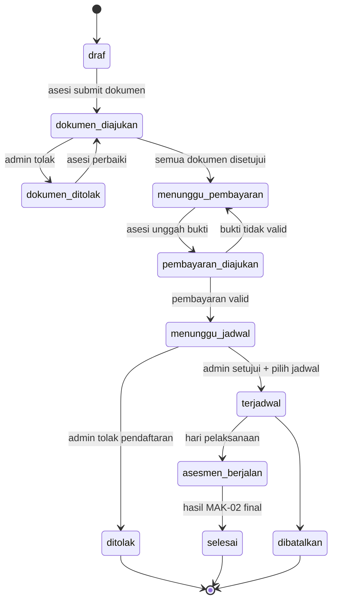

> Bila biaya nol (ditanggung sponsor), transisi `menunggu_pembayaran` dilewati otomatis. Urutan bayar vs setujui dapat disesuaikan LSP lewat konfigurasi (lihat pertanyaan terbuka BRD).

#### 6.1.1 Aturan Penguncian Portal Asesi (Strict Phase Gating & Validasi)

1. **Strict Phase Gating (Anti-Lompat Tahapan):**
   - Portal asesi dikunci berbasis tahapan verifikasi ketat.
   - Asesi **dilarang melompat** ke tahapan berikutnya sebelum tahapan sebelumnya berstatus valid di server:
     - Tahap APL-01: Registrasi, profil lengkap, NIK 16 digit, dan unggahan berkas persyaratan.
     - Tahap Verifikasi: Admin memeriksa berkas. Status wajib `disetujui` sebelum melangkah.
     - Tahap Pembayaran: Validasi bukti bayar oleh Admin (bila berbayar).
     - Tahap Plotting & Persetujuan: Admin memplot asesi ke jadwal dan menetapkan status `terjadwal`.
     - Tahap APL-02: Formulir Asesmen Mandiri **baru terbuka** dan boleh diisi asesi hanya jika pendaftaran telah `terjadwal`.
     - Tahap Asesmen: Pelaksanaan uji oleh Asesor, input MAK-02 hingga berstatus `selesai`.
   - Percobaan akses route tahapan yang belum terbuka langsung dialihkan (redirect) kembali ke tahapan aktif dengan pesan peringatan.

2. **Panduan Sistem & Alur Interaktif:**
   - Dashboard asesi menyediakan widget download dokumen dan CMS interaktif yang memuat Panduan Penggunaan Sistem dan Alur Kerja Sertifikasi bagi Peserta.

3. **Validasi Payload Ketat:**
   - **NIK:** Wajib persis 16 digit angka (`regex:/^\d{16}$/`), divalidasi di FormRequest dan frontend.
   - **Portofolio & Berkas:** Limit ukuran maksimal 2MB–5MB, format diperbolehkan hanya PDF (`application/pdf`), JPG (`image/jpeg`), dan PNG (`image/png`).
   - **Integritas MIME:** Wajib validasi MIME tipe riil di sisi server (`finfo`) sebelum disimpan di disk privat `uploads/{institution_id}/`. Ekstensi saja tidak cukup.

### 6.2 Status Asesi (Turunan)

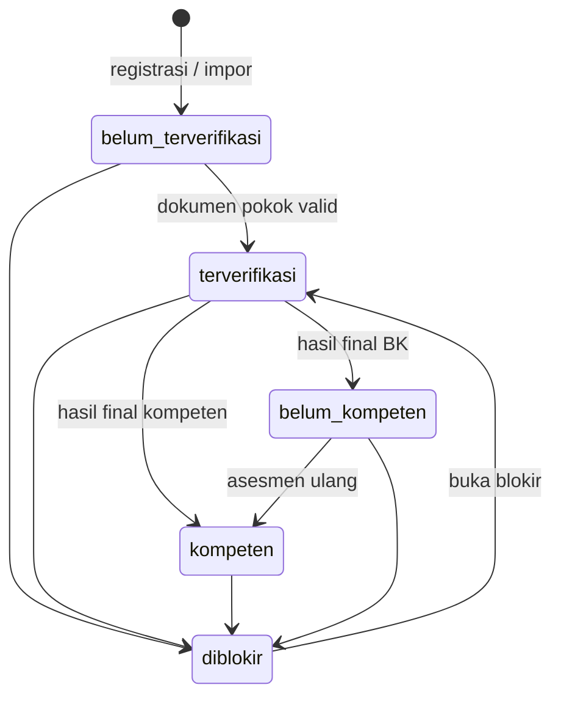

`diblokir` direpresentasikan oleh `users.status`, bukan kolom asesi, agar blokir berlaku pada login.

### 6.3 Dokumen, Notifikasi, Hasil

| Entitas             | Status                                   | Transisi                                                        |
| ------------------- | ---------------------------------------- | --------------------------------------------------------------- |
| Dokumen persyaratan | menunggu → disetujui / ditolak          | Final; koreksi hanya oleh admin dengan alasan (audit)           |
| Notifikasi          | menunggu → terkirim / gagal             | `gagal` → `menunggu` lewat Kirim Ulang atau retry otomatis |
| APL-02              | draf_asesi → diserahkan → diverifikasi |                                                                 |
| Hasil MAK-02        | draf → final                            | Final mengunci; memicu pembaruan status asesi dan sertifikat    |

### 6.4 Keanggotaan Lintas LSP **(Revisi multi-LSP)**

Berlaku untuk `institution_user`, `asesor_institutions`, dan `asesi_institutions`.

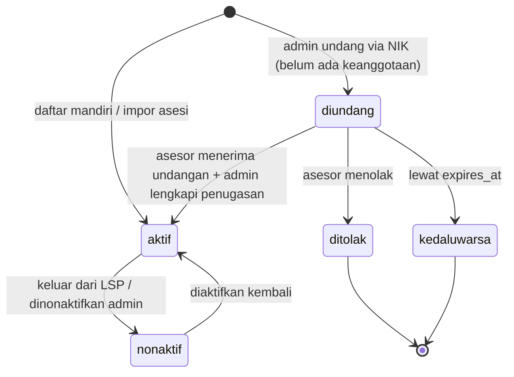

Aturan:

- Penonaktifan **tidak menghapus data**: penugasan lampau, hasil asesmen, dan audit tetap utuh; penugasan **mendatang** di LSP tersebut dibatalkan atau digantikan (BR-RULE-29).
- `nonaktif` di LSP B tidak mengubah status keanggotaan di LSP A (BR-RULE-29; diuji pada 4.2.7).
- Hanya keanggotaan `aktif` yang muncul pada tenant switcher dan dapat menjadi konteks sesi.

---

## 7. Alur Interaksi Utama

### 7.1 Persetujuan Pendaftaran dan Plotting (FR-REG-05/06/07, FR-SCH-08/09)

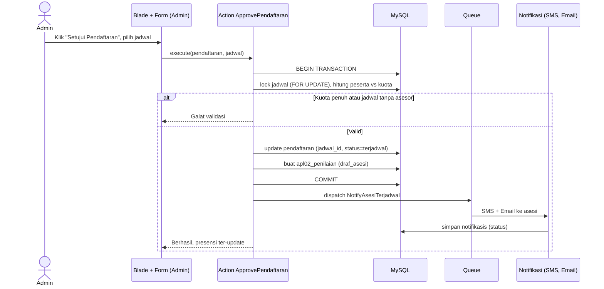

### 7.2 Verifikasi APL-02 dan Input MAK-02 oleh Asesor

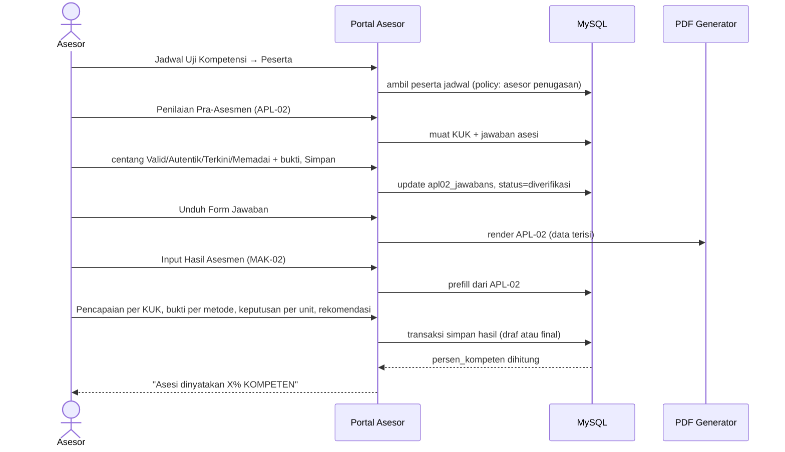

### 7.3 Impor Asesi dari Excel (FR-ASI-08/09/10)

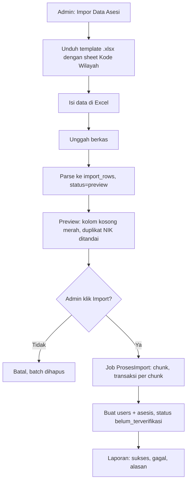

### 7.4 Pola Notifikasi (Outbox)

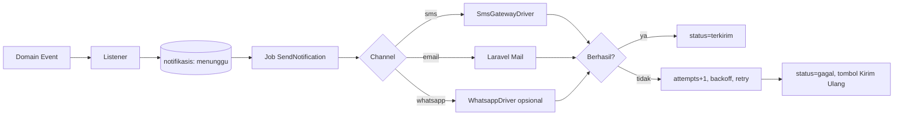

### 7.5 Undangan dan Penautan Asesor Lintas LSP **(Revisi multi-LSP)**

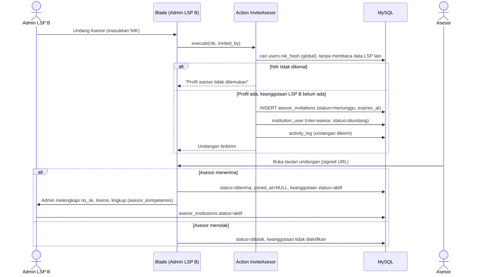

Catatan implementasi:

- Pencarian hanya memakai `nik_hash` global; respons galat identik untuk NIK yang tidak ada maupun diblokir (tidak membocorkan keberadaan orang di LSP lain).
- Admin LSP B tidak pernah menerima kolom profil milik LSP A selain data yang memang global (nama, no. MET).
- `POST /undangan/{invitation}/terima` dan `/tolak` ber-`signed` + throttle; keputusan tercatat di audit.

### 7.6 Plotting Asesor Lintas LSP dan Cek Bentrok **(Revisi multi-LSP)**

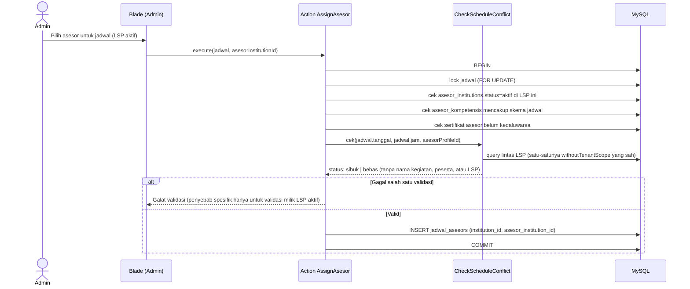

Aturan: `CheckScheduleConflict` hanya mengembalikan **sibuk/bebas** beserta tanggal dan jam milik pengguna itu sendiri; detail jadwal milik LSP lain tidak pernah diserialisasi (BR-RULE-25).

---

## 8. Routing dan Navigasi

### 8.1 Konvensi

| Portal | Prefix      | Guard/Middleware                                          | Login                   |
| ------ | ----------- | --------------------------------------------------------- | ----------------------- |
| Publik | `/`       | — (redirect ke login/dashboard)                            | `/login`             |
| Admin  | `/admin`  | `auth`, `tenant.context`, `role:admin\|super-admin`, `setup.completed`, `not.blocked` | username + password     |
| Asesor | `/asesor` | `auth`, `tenant.context`, `role:asesor`, `not.blocked` | NIK + password          |
| Asesi  | `/asesi`  | `auth`, `tenant.context`, `role:asesi`, `not.blocked`  | NIK/email + password    |

`tenant.context` (`EnsureTenantContext`) menetapkan dan memvalidasi `session('active_institution_id')` setelah login; tidak ada resolusi dari domain/subdomain. Resource lembaga lain ditolak oleh global scope + policy (404). Area `/platform` untuk Super Admin lintas tenant belum termasuk MVP (fase lanjutan).

Route model binding memakai UUID: `/admin/asesi/{asesi}`; nama route: `admin.asesi.index`, `asesor.jadwal.peserta`, dst.

### 8.2 Peta Menu dan Route

**Admin**

| Menu                          | Route (ringkas)                                                                                | FR            |
| ----------------------------- | ---------------------------------------------------------------------------------------------- | ------------- |
| Dashboard                     | `GET /admin`                                                                                 | FR-RPT-01     |
| Pengaturan Awal (sementara)   | `/admin/setup`                                                                               | FR-SET-01     |
| Lembaga Sertifikasi Profesi   | `/admin/lsp`                                                                                 | FR-LSP        |
| SKKNI                         | `/admin/skkni`                                                                               | FR-STD-01     |
| Skema Sertifikasi             | `/admin/skema`, `/admin/skema/{skema}/persyaratan`                                         | FR-STD-02..04 |
| Unit Kompetensi               | `/admin/unit`, `/admin/unit/{unit}/elemen`, `/admin/elemen/{elemen}/kuk`                 | FR-STD-05..07 |
| TUK                           | `/admin/tuk`                                                                                 | FR-SCH-01     |
| Event Uji Kompetensi          | `/admin/event`                                                                               | FR-SCH-03     |
| Jadwal Uji Kompetensi         | `/admin/jadwal`, `/admin/jadwal/{jadwal}/peserta`, `/admin/jadwal/{jadwal}/presensi.pdf` | FR-SCH-04..09 |
| Asesi                         | `/admin/asesi`, `/admin/asesi/impor`, `/admin/asesi/{asesi}`                             | FR-ASI        |
| Calon Asesi (Baru)            | `/admin/calon-asesi`                                                                         | FR-REG        |
| Pendaftaran Asesmen           | `/admin/pendaftaran`, `/admin/pendaftaran/{p}/verifikasi`                                  | FR-REG        |
| Asesor                        | `/admin/asesor`                                                                              | FR-ASR-01     |
| Keanggotaan LSP (peran & status) | `/admin/keanggotaan`, `/admin/keanggotaan/{iu}/nonaktifkan`                             | FR-AUTH-08 **(Revisi multi-LSP)** |
| Undangan & penautan asesor    | `/admin/asesor/undangan`, `/admin/asesor/undangan/{inv}/batalkan`                        | FR-ASR-09 **(Revisi multi-LSP)** |
| Lingkup kompetensi asesor     | `/admin/asesor/{ai}/lingkup`                                                              | FR-ASR-10 **(Revisi multi-LSP)** |
| Biaya                         | `/admin/biaya`, `/admin/rekening-bank`                                                     | FR-PAY        |
| Pembayaran                    | `/admin/pembayaran`                                                                          | FR-PAY-05     |
| Formulir Pra-Asesmen          | `/admin/formulir`                                                                            | FR-FRM-02     |
| Notifikasi (SMS Masuk/Keluar) | `/admin/notifikasi/keluar`, `/admin/notifikasi/masuk`                                      | FR-NTF        |
| Konten Frontpage Website      | `/admin/cms`                                                                                 | FR-CMS        |
| Laporan & Sertifikat          | `/admin/laporan`, `/admin/sertifikat`                                                      | FR-RPT        |
| Pengguna & Peran              | `/admin/pengguna`                                                                            | FR-AUTH-08    |
| Audit Log                     | `/admin/audit`                                                                               | NFR-11        |
| Profil, Ubah Sandi            | `/admin/profil`, `/admin/sandi`                                                            | FR-AUTH-03/06 |

**Platform** (khusus Super Admin platform, lintas tenant): `/platform` (ringkasan), `/platform/lsp` (CRUD + aktivasi), `/platform/pengguna` (admin platform), `/platform/audit` (audit lintas tenant), `/platform/kuota`.

**Asesor** (mengikuti menu SILSP)

| Menu                  | Route                                        | FR            |
| --------------------- | -------------------------------------------- | ------------- |
| Home                  | `/asesor`                                  | FR-ASR-04     |
| Jadwal Uji Kompetensi | `/asesor/jadwal`                           | FR-ASR-06     |
| Peserta               | `/asesor/jadwal/{jadwal}/peserta`          | FR-ASR-07     |
| APL-02                | `/asesor/pendaftaran/{p}/apl02`            | FR-ASM-02     |
| Undangan Saya         | `/asesor/undangan`, `/asesor/undangan/{inv}/terima`, `/asesor/undangan/{inv}/tolak` | FR-ASR-09 **(Revisi multi-LSP)** |
| Jadwal Saya (lintas LSP, opsional) | `/asesor/jadwal-saya`           | FR-ASR-12 **(Revisi multi-LSP)** |
| MAK-02                | `/asesor/pendaftaran/{p}/mak02`            | FR-ASM-05..07 |
| Unduh formulir        | `/asesor/pendaftaran/{p}/formulir/{jenis}` | FR-FRM        |
| SMS Notifikasi        | `/asesor/notifikasi`                       | FR-NTF-04     |
| Profil / Ubah Sandi   | `/asesor/profil`, `/asesor/sandi`        | FR-AUTH       |

**Asesi**

| Menu                     | Route                                 | FR             |
| ------------------------ | ------------------------------------- | -------------- |
| Beranda                  | `/asesi`                            | Status ringkas |
| Profil & Dokumen Pokok   | `/asesi/profil`                     | FR-ASI-02      |
| Pendaftaran Skema        | `/asesi/pendaftaran`                | FR-REG-01      |
| Dokumen Persyaratan      | `/asesi/pendaftaran/{p}/dokumen`    | FR-REG-01      |
| Pembayaran               | `/asesi/pendaftaran/{p}/pembayaran` | FR-PAY-04      |
| Persetujuan berbagi dokumen | `/asesi/consent`, `/asesi/consent/{c}/cabut` | FR-ASI-14 **(Revisi multi-LSP)** |
| Jadwal Saya              | `/asesi/jadwal`                     |                |
| Asesmen Mandiri (APL-02) | `/asesi/pendaftaran/{p}/apl02`      | FR-ASM-01      |
| Hasil & Sertifikat       | `/asesi/hasil`                      | FR-RPT-04      |
| Notifikasi               | `/asesi/notifikasi`                 |                |

**Publik**: `/`, `/skema`, `/asesor`, `/berita`, `/berita/{slug}`, `/kontak`, `/verifikasi-sertifikat/{kode}`, `/daftar`, `/masuk`.

---

## 9. Desain Antarmuka (Tabler UI)

### 9.1 Pemasangan

```bash
npm install @tabler/core @tabler/icons-webfont
```

```js
// resources/js/app.js
import '@tabler/core/dist/js/tabler.min.js';
```

```scss
// resources/css/app.scss
@import '@tabler/core/dist/css/tabler.min.css';
@import '@tabler/icons-webfont/dist/tabler-icons.min.css';
```

Alternatif cepat saat prototipe: CDN jsDelivr `@tabler/core` (pin versi eksak). Gunakan pustaka tabel/grafik sesuai kebutuhan: Tabler Charts memakai **ApexCharts**; editor konten CMS memakai **TinyMCE** atau **Quill/Trix** (hasil disanitasi di server).

### 9.2 Layout

| Layout             | Tabler pattern                                                             | Dipakai oleh                                  |
| ------------------ | -------------------------------------------------------------------------- | --------------------------------------------- |
| `layouts.admin`  | **Vertical layout** (`navbar-vertical`) + page header + breadcrumb | Admin, Asesor, Asesi (menu berbeda per peran) |
| `layouts.auth`   | Halaman *sign-in* Tabler (card di tengah)                                | Login semua portal                            |
| `layouts.lock`   | Halaman auth dengan avatar + 1 input password                              | Lock screen (FR-AUTH-02)                      |
| `layouts.public` | **Horizontal/top navbar** + hero banner + footer                     | Website frontpage                             |

Padanan elemen SILSP → Tabler:

| Elemen SILSP                                                | Komponen Tabler                                                                 |
| ----------------------------------------------------------- | ------------------------------------------------------------------------------- |
| Menu samping                                                | `navbar-vertical` + `nav-item` + ikon Tabler Icons                          |
| Tombol Toggle Menu                                          | `navbar-toggler`                                                              |
| Navigasi Breadcrumb                                         | `breadcrumb` di `page-header`                                               |
| Kartu statistik berwarna (Jadwal, Skema, Portofolio, Asesi) | `card card-sm` dengan `avatar`/ikon dan angka besar (`h1`)                |
| Grafik (Pendaftar tahun, Kelompok usia, Jenis kelamin)      | `card` + ApexCharts                                                           |
| Tabel data dengan pencarian "Menampilkan N data"            | `table card-table table-vcenter` + `input-icon` pencarian + paginasi Tabler |
| Tombol aksi (Peserta, Presensi, Unduh)                      | `btn btn-sm` / `btn-list` / `dropdown` bila banyak aksi                   |
| Tab (Kompeten, Belum Kompeten, …)                          | `nav-tabs` di dalam `card-header`                                           |
| Pop-up pratinjau dokumen                                    | `modal modal-blur modal-xl` dengan `iframe`                                 |
| Notifikasi "berhasil disimpan"                              | `alert alert-success alert-dismissible` / toast                               |
| Status SMS/Dokumen                                          | `badge bg-green-lt / bg-red-lt / bg-yellow-lt`                                |
| Form isian                                                  | `form-label`, `form-control`, `form-select`, `row g-3`                  |
| Alur tahapan asesi                                          | `steps` (Tabler stepper)                                                      |

### 9.3 Konvensi Status (Warna + Teks)

| Status                                                  | Badge            | Ikon               |
| ------------------------------------------------------- | ---------------- | ------------------ |
| Menunggu                                                | `bg-yellow-lt` | `ti-clock`       |
| Disetujui / Valid / Terkirim / Kompeten / Pencapaian Ya | `bg-green-lt`  | `ti-check`       |
| Ditolak / Gagal / Belum Kompeten / Pencapaian Tidak     | `bg-red-lt`    | `ti-x`           |
| Asesmen Lanjut                                          | `bg-azure-lt`  | `ti-arrow-right` |
| Diblokir                                                | `bg-dark-lt`   | `ti-lock`        |

Selalu sertakan **teks atau ikon** di samping warna (NFR-15).

### 9.4 Rancangan Layar Kunci (Wireframe Tekstual)

**A. Dashboard Admin/Asesor**

```
[Page header: Dashboard · Sistem Informasi LSP            Breadcrumb: Home / Dashboard]
[Stat: Skema] [Stat: Asesor] [Stat: Asesi/Calon] [Stat: Uji Kompetensi] [Stat: Jadwal]
[Card Grafik: Pendaftar & Kandidat per Tahun (line)] [Card: Kelompok Usia Asesi (bar)]
[Card: Jenis Kelamin (donut)]                       [Card: Kemajuan Proses Administratif (progress)]
```

Dashboard asesor: stat *Jadwal Asesmen Anda, Skema Asesmen Anda, Portofolio Asesmen Anda, Asesi yang Anda Asesori*.

**B. Daftar Jadwal (Admin/Asesor)** — tabel: No | Kegiatan/Periode/Waktu/Tempat | Skema, Kapasitas, Peserta, Asesor | Aksi (`Peserta`, `Presensi`, `Hapus` bila kosong). Form tambah jadwal di bawah (card) dengan 12 isian sesuai FR-SCH-04, dua kolom.

**C. Manajemen Asesi (Admin)** — filter Provinsi/Kota (select + ringkasan jumlah), tab status, tabel (foto, nama, no. pendaftaran, pendidikan, skema, kelengkapan dokumen), tombol `Detail`, `Verifikasi`, `Blokir`, `Hapus` (hanya tab belum terverifikasi), tombol hijau **Impor Data Asesi**.

**D. Verifikasi Dokumen** — daftar dokumen persyaratan: nama, status badge, tombol *lihat* (modal pratinjau) dan `Setujui` / `Tolak` (modal catatan). Di footer: **Setujui Pendaftaran** (modal pilih jadwal) / **Tolak Pendaftaran**.

**E. Verifikasi APL-02 (Asesor)** — kartu per Unit → Elemen → KUK: pertanyaan, jawaban asesi, textarea *Bukti-Bukti Kompetensi*, 4 checkbox (`Valid`, `Autentik`, `Terkini`, `Memadai`). Footer sticky: `Kembali` · `Unduh Form Jawaban` · `Simpan Jawaban`.

**F. Input Hasil MAK-02 (Asesor)** — per KUK radio *Ya/Tidak* (kartu hijau/merah), blok metode (Observasi, Tes Lisan, Tes Tertulis) dengan checkbox bukti + Pencapaian + Keputusan; panel akhir *Direkomendasikan / Tidak Direkomendasikan*; footer `Kembali` · `Unduh Form Hasil` · `Simpan Jawaban`. Setelah simpan: alert "Asesi dinyatakan X% KOMPETEN".

**G. Notifikasi Keluar** — tabel: Waktu | Tujuan | Pesan | Status badge | `Kirim Ulang` untuk Gagal.

### 9.5 Komponen Blade Reusable

| Komponen                                    | Props                                                                         |
| ------------------------------------------- | ----------------------------------------------------------------------------- |
| `<x-tabler.stat>`                         | `label`, `value`, `icon`, `color`, `href`                           |
| `<x-tabler.status-badge>`                 | `status` (enum), otomatis warna + ikon                                      |
| `<x-tabler.card>`                         | `title`, slot `actions`, slot `footer`                                  |
| `<x-tabler.table-search>`                 | `placeholder`, `perPage`                                                  |
| `<x-tabler.confirm>`                      | modal konfirmasi hapus/blokir (dengan alasan opsional)                        |
| `<x-tabler.file-preview>`                 | modal iframe/img dengan URL bertanda tangan                                   |
| `<x-tabler.empty>`                        | ilustrasi kosong ("Belum Ada Peserta")                                        |
| `<x-form.input>` / `select` / `money` | label, error, format Rupiah (tampil berformat, simpan angka murni, FR-PAY-06) |

---

## 10. Keamanan

| Area         | Kontrol                                                                                                                                                             |
| ------------ | ------------------------------------------------------------------------------------------------------------------------------------------------------------------- |
| Transport    | HTTPS wajib, HSTS, cookie `Secure`, `HttpOnly`, `SameSite=Lax`                                                                                                |
| Autentikasi  | Hash Argon2id/bcrypt; min. 8 karakter (disarankan cek password umum); rate limit login (mis. 5/menit/IP+akun); regenerate session saat login; lock screen saat idle |
| Otorisasi    | Policy per model (`JadwalPolicy`, `PendaftaranPolicy`, …); asesor hanya data penugasannya (BR-RULE-18); asesi hanya miliknya; middleware peran                 |
| Isolasi tenant | Semua query tenant-scoped melewati `BelongsToTenant`; `institution_id` tidak dapat diisi dari request; policy memeriksa tenant; uji lintas tenant wajib (bagian 4.2) |
| IDOR         | UUID + policy (UUID bukan pengganti otorisasi)                                                                                                                      |
| Data pribadi | NIK dienkripsi (`encrypted` cast) + `nik_hash` HMAC untuk pencarian/unique; masking di tampilan (tampilkan 4 digit akhir kecuali yang berwenang)                |
| Berkas       | Disk privat, akses via controller/signed URL kadaluarsa; validasi MIME sebenarnya + ekstensi + ukuran; nama berkas acak; pindai antivirus (opsional, ClamAV)        |
| Input        | FormRequest validasi ketat; sanitasi HTML CMS (allowlist, mis. HTMLPurifier); sanitasi embed Google Maps                                                            |
| Injeksi      | Eloquent/query binding; hindari `DB::raw` tanpa binding; Blade `{{ }}` escaping                                                                                 |
| CSRF         | Token Laravel pada semua form Blade (`@csrf`); pengecualian hanya webhook terverifikasi signature                                                                                                                        |
| Audit        | Activity log: login, perubahan master, keputusan verifikasi, hasil, koreksi admin, blokir                                                                           |
| Rahasia      | `.env` di luar repo; rotasi kunci SMS/SMTP; `APP_KEY` terkelola                                                                                                 |
| Header       | CSP, X-Frame-Options, Referrer-Policy, Permissions-Policy                                                                                                           |
| Backup       | Dump MySQL harian terenkripsi + salinan penyimpanan berkas; uji pemulihan berkala                                                                                   |
| Privasi      | Retensi dan penghapusan data sesuai kebijakan; persetujuan (consent) saat registrasi; log akses berkas sensitif                                                     |

---

## 11. Integrasi dan Layanan Pendukung

### 11.1 Adapter Notifikasi

```php
interface NotificationChannel
{
    public function send(Notifikasi $notifikasi): ProviderResult; // ref, success, error
}

// config/notifikasi.php
return [
    'default_sms' => env('SMS_DRIVER', 'http'),
    'drivers' => [
        'http' => [
            'class'  => \App\Domain\Notifikasi\Channels\HttpSmsGateway::class,
            'url'    => env('SMS_API_URL'),
            'token'  => env('SMS_API_TOKEN'),
            'sender' => env('SMS_SENDER_ID'),
        ],
    ],
    'retry' => ['tries' => 3, 'backoff' => [60, 300, 900]],
];
```

Penyedia SMS dapat diganti tanpa mengubah modul lain (FR-NTF-06). Webhook status pengiriman (jika ada) memperbarui `notifikasis.status`; endpoint SMS masuk menyimpan ke `sms_masuks` (FR-NTF-03).

### 11.2 Pembuat PDF Formulir

| Formulir   | View               | Sumber Data                                               |
| ---------- | ------------------ | --------------------------------------------------------- |
| APL-01     | `pdf.apl01`      | Profil asesi, pekerjaan, skema, kop LSP                   |
| APL-02     | `pdf.apl02`      | Unit-Elemen-KUK, jawaban asesi, verifikasi asesor         |
| MAK-01     | `pdf.mak01`      | Persetujuan asesmen & kerahasiaan                         |
| MAK-02     | `pdf.mak02`      | Hasil per KUK/unit/metode, rekomendasi                    |
| MAK-03     | `pdf.mak03`      | Sesuai templat LSP                                        |
| Presensi   | `pdf.presensi`   | Peserta per jadwal (selalu dihitung real-time, FR-SCH-08) |
| Sertifikat | `pdf.sertifikat` | Data asesi + QR verifikasi                                |

Pembuatan PDF berat dijalankan sebagai job bila diperlukan; PDF kecil dirender sinkron dan di-*stream*.

### 11.3 Impor Excel

`maatwebsite/excel` dengan `ToCollection` + `WithChunkReading`; kolom wilayah menerima kode 6 digit dan dipetakan ke `provinces/cities/districts`. Template menyertakan sheet *Kode Wilayah* (FR-ASI-09). Validasi: NIK 16 digit, email, tanggal, duplikat NIK di berkas dan database.

### 11.4 Scheduler

| Tugas                      | Frekuensi      | Fungsi                                         |
| -------------------------- | -------------- | ---------------------------------------------- |
| `notifikasi:retry-gagal` | setiap 5 menit | Retry notifikasi menunggu/gagal sesuai backoff |
| `lisensi:ingatkan`       | harian         | Pengingat lisensi LSP/TUK/asesor (FR-LSP-03)   |
| `jadwal:perbarui-status` | per jam        | `terbuka → berjalan → selesai`             |
| `import:bersihkan`       | harian         | Hapus batch preview kedaluwarsa                |
| `backup:run`             | harian         | Backup database dan berkas                     |

Seluruh tugas dijalankan **per tenant aktif** (atau `--all-tenants` untuk tugas platform seperti backup), dengan context tenant di-bind sebelum eksekusi.

---

## 12. Contoh Implementasi Kunci

### 12.1 Action Persetujuan Pendaftaran

```php
class ApprovePendaftaran
{
    public function __invoke(Pendaftaran $pendaftaran, JadwalAsesmen $jadwal, User $admin): Pendaftaran
    {
        return DB::transaction(function () use ($pendaftaran, $jadwal, $admin) {
            $jadwal = JadwalAsesmen::whereKey($jadwal->getKey())->lockForUpdate()->firstOrFail();

            throw_if($jadwal->institution_id !== $pendaftaran->institution_id, DomainException::class, 'Tenant pendaftaran dan jadwal tidak sama.');
            throw_if($jadwal->asesors()->doesntExist(), DomainException::class, 'Jadwal belum memiliki asesor.');
            throw_if($jadwal->skema_id !== $pendaftaran->skema_id, DomainException::class, 'Skema jadwal tidak sesuai.');
            throw_if($jadwal->pendaftarans()->count() >= $jadwal->kuota, DomainException::class, 'Kuota jadwal penuh.');

            $pendaftaran->update([
                'jadwal_id'      => $jadwal->id,
                'status'         => PendaftaranStatus::Terjadwal,
                'disetujui_oleh' => $admin->id,
                'disetujui_pada' => now(),
            ]);

            Apl02Penilaian::firstOrCreate(['pendaftaran_id' => $pendaftaran->id], [
                'status' => Apl02Status::DrafAsesi,
            ]);

            event(new PendaftaranDisetujui($pendaftaran)); // listener -> outbox SMS+Email (queue)

            return $pendaftaran->refresh();
        });
    }
}
```

### 12.2 Policy Akses Asesor

```php
class JadwalAsesmenPolicy
{
    public function view(User $user, JadwalAsesmen $jadwal): bool
    {
        if ($user->hasAnyRole(['super-admin', 'admin'])) {
            return true;
        }

        return $user->hasRole('asesor')
            && $jadwal->asesors()->where('asesor_id', $user->asesor?->id)->exists();
    }
}
```

### 12.3 Middleware Setup dan Blokir

```php
class EnsureSetupCompleted
{
    public function handle($request, Closure $next)
    {
        if (! Setting::get('setup_completed_at') && ! $request->routeIs('admin.setup.*')) {
            return redirect()->route('admin.setup.index');
        }

        return $next($request);
    }
}
```

`EnsureNotBlocked` memeriksa `auth()->user()->status === 'diblokir'` lalu logout dengan pesan.

### 12.4 Perhitungan Persentase dan Keputusan

| Hitungan            | Rumus                                                                                                                   |
| ------------------- | ----------------------------------------------------------------------------------------------------------------------- |
| `persen_kompeten` | (jumlah KUK pencapaian Ya ÷ total KUK) × 100                                                                          |
| Keputusan unit      | `kompeten` bila semua KUK unit tercapai; selain itu asesor memilih `belum_kompeten` atau `asesmen_lanjut`         |
| Status asesi        | `kompeten` bila semua unit `kompeten` **dan** rekomendasi `direkomendasikan`; selain itu `belum_kompeten` |

---

## 13. Non-Fungsional dalam Implementasi

| NFR                   | Pendekatan                                                                                                                                  |
| --------------------- | ------------------------------------------------------------------------------------------------------------------------------------------- |
| Kinerja (NFR-08)      | Pagination server-side, eager loading, indeks (bagian 5.3), cache data master (`Cache::remember` + invalidasi saat ubah), queue untuk I/O |
| Ketersediaan (NFR-09) | Health check endpoint, Supervisor auto-restart worker, backup + uji restore                                                                 |
| Observabilitas        | Log terstruktur (JSON), Sentry/Flare opsional, Laravel Pulse/Telescope (dev/stage)                                                          |
| Pengujian             | Unit (Action, hitungan persen), Feature (policy, alur pendaftaran), PHPUnit + Dusk (isolasi tenant & alur kritis)                               |
| CI/CD                 | GitHub Actions: Pint, Larastan, Pest, build Vite, deploy via rilis atomik                                                                   |
| Lingkungan            | Local (Docker Compose), Staging, Production; `.env` terpisah                                                                              |
| Lokalisasi            | `id` sebagai locale default (`lang/id`), format tanggal `d F Y`, mata uang Rupiah                                                     |
| Zona waktu            | `Asia/Jakarta` (tampilan); penyimpanan UTC                                                                                                |

---

## 14. Rencana Implementasi

| Fase                     | Cakupan                                                                          | Modul         | Luaran                     |
| ------------------------ | -------------------------------------------------------------------------------- | ------------- | -------------------------- |
| 0. Fondasi               | Proyek Laravel, Docker, CI, UUID base model, tenant context + `institution_id`, layout Tabler, auth + RBAC, audit | AUTH, TENANCY | Kerangka siap (single-LSP, siap multi-LSP) |
| 1. Master                | Setup awal, LSP, SKKNI, Skema, Persyaratan, Unit/Elemen/KUK, TUK, wilayah        | SET, LSP, STD | Data standar dapat diinput |
| 2. Penjadwalan           | Event, Jadwal, Asesor + portal asesor dasar, presensi PDF                        | SCH, ASR      | Jadwal dan penugasan       |
| 3. Asesi dan Pendaftaran | Registrasi, profil, impor Excel, dokumen, verifikasi, persetujuan, notifikasi    | ASI, REG, NTF | Pendaftaran end-to-end     |
| 4. Biaya dan Pembayaran  | Biaya, rekening, pembayaran, validasi                                            | PAY           | Alur bayar                 |
| 5. Asesmen               | APL-02, MAK-02, formulir PDF lengkap                                             | ASM, FRM      | Asesmen daring             |
| 6. Hasil dan Laporan     | Status kompeten, sertifikat, dashboard, laporan                                  | RPT           | Rilis inti                 |
| 7. CMS dan Publik        | Konten frontpage, verifikasi sertifikat, SEO                                     | CMS           | Website LSP                |
| 8. Hardening             | Uji keamanan, performa, UAT, migrasi data SILSP (jika ada), dokumentasi pengguna | —            | Go-live                    |

### 14.1 Urutan Migrasi Database

`institutions` (root tenant) → `users` (dengan `institution_id` nullable untuk platform) → `roles/permissions` → `app_settings` (unique `institution_id,key`) → `provinces/cities/districts` (global) → `tuks` → `rekening_banks` → `skknis` → `skemas` → `skema_persyaratans` → `unit_kompetensis` → `elemen_kompetensis` → `kriteria_unjuk_kerjas` → `biayas` → `asesors` → `asesis` → `import_batches/rows` → `event_asesmens` → `jadwal_asesmens` → `jadwal_asesors` → `pendaftarans` → `pendaftaran_dokumens` → `pembayarans` → `apl02_*` → `hasil_asesmen*` → `sertifikats` → `notifikasis`, `sms_masuks`, `notification_templates` → `cms_kontens` → `activity_log`.

Catatan: setiap tabel tenant-scoped dibuat dengan `institution_id` + indeks komposit sejak migrasi pertama. `institutions` harus dibuat sebelum tabel tenant mana pun.

### 14.2 Seeder

| Seeder                     | Isi                                                                |
| -------------------------- | ------------------------------------------------------------------ |
| InstitutionSeeder          | Dua lembaga demo (`siap-kompeten`, `mitra-nusantara`) + admin lintas lembaga (`admin@siapkompeten.test`) |
| RolePermissionSeeder       | Peran dan izin dasar (super-admin-platform, admin, asesor, asesi, pimpinan) |
| WilayahSeeder              | Provinsi/kota/kecamatan (kode 6 digit)                             |
| SuperAdminSeeder           | Akun platform (`institution_id=null`) dari `.env` (fase lanjutan)  |
| NotificationTemplateSeeder | Template pesan standar per tenant                                  |
| DemoSeeder (non-prod)      | Contoh skema (mis. Pembuatan Pola Batik), jadwal, asesor, asesi    |

---

## 15. Risiko Teknis dan Mitigasi

| Risiko                                         | Dampak                         | Mitigasi                                                                                 |
| ---------------------------------------------- | ------------------------------ | ---------------------------------------------------------------------------------------- |
| Format formulir resmi berbeda antar LSP        | Template PDF sering berubah    | Template Blade terpisah per formulir, mudah diganti; kop dan teks statis dari pengaturan |
| UUID `CHAR(36)` memperbesar indeks           | Kinerja pada data sangat besar | UUID v7, indeks komposit terarah; opsi `BINARY(16)` bila perlu                         |
| Ketergantungan penyedia SMS                    | Notifikasi tertunda            | Adapter, retry, kirim ulang manual, kanal Email sebagai cadangan                         |
| Data pribadi sensitif (NIK, dokumen)           | Risiko kebocoran               | Enkripsi, disk privat, signed URL, audit akses, HTTPS                                    |
| Perubahan struktur standar setelah ada asesmen | Hasil lama tidak konsisten     | Soft delete, nonaktif alih-alih hapus, opsi duplikasi skema versi baru                   |
| Kuota/jadwal balapan (race condition)          | Kelebihan peserta              | `lockForUpdate` di transaksi plotting                                                  |
| Kebocoran data lintas tenant              | Kepercayaan & kepatuhan rusak  | Scope wajib + policy tenant + FK komposit + test lintas tenant + audit akses platform |
| "Noisy neighbor" (satu LSP membebani)     | Tenant lain melambat          | Indeks `institution_id`, queue terpisah/prioritas, kuota penyimpanan & rate limit per tenant |
| Ketidakjelasan proses asesi                    | Rework UI asesi                | Validasi alur dengan LSP di Fase 0, prototipe Tabler                                     |

---

## 16. Keputusan Desain dan Pertanyaan Terbuka

| No | Keputusan/Pertanyaan                          | Usulan Sementara                                                                                                                 |
| -- | --------------------------------------------- | -------------------------------------------------------------------------------------------------------------------------------- |
| 1  | Relasi unit–skema                            | Dimulai 1:N sesuai SILSP; bila N:M dibutuhkan, tambah pivot `skema_unit` tanpa mengubah tabel hasil (hasil merujuk `kuk_id`) |
| 2  | Urutan bayar vs setujui pendaftaran           | Konfigurable per LSP (default: dokumen → bayar → plotting, sesuai diagram SILSP)                                               |
| 3  | Livewire vs DataTables                        | **Tanpa Livewire** (keputusan pemilik produk): Blade murni + form HTML/CSS; tabel server-side dengan pagination Laravel               |
| 4  | Tanda tangan digital                          | Fase 1 hanya kolom TTD pada PDF; TTD digital fase lanjut                                                                         |
| 5  | Multi-asesor per jadwal                       | Skema DB sudah mendukung (`jadwal_asesors.peran`); UI awal satu asesor                                                         |
| 6  | Integrasi BNSP                                | Di luar fase 1; rancang `Sertifikat` agar mudah diekspor                                                                       |
| 7  | Format nomor sertifikat dan nomor pendaftaran | Menunggu ketentuan LSP                                                                                                           |
| 8  | Multitenancy (multi-LSP)                      | Shared database + kolom `institution_id`; MVP satu LSP, skema & middleware siap multi-LSP sejak Fase 0 (bagian 4.2)                    |

---

*Disusun oleh Muhamad Arya Kurniawan. Dokumen ini adalah rancangan awal untuk diskusi dan validasi; detail teknis dapat disesuaikan pada tahap implementasi.*
